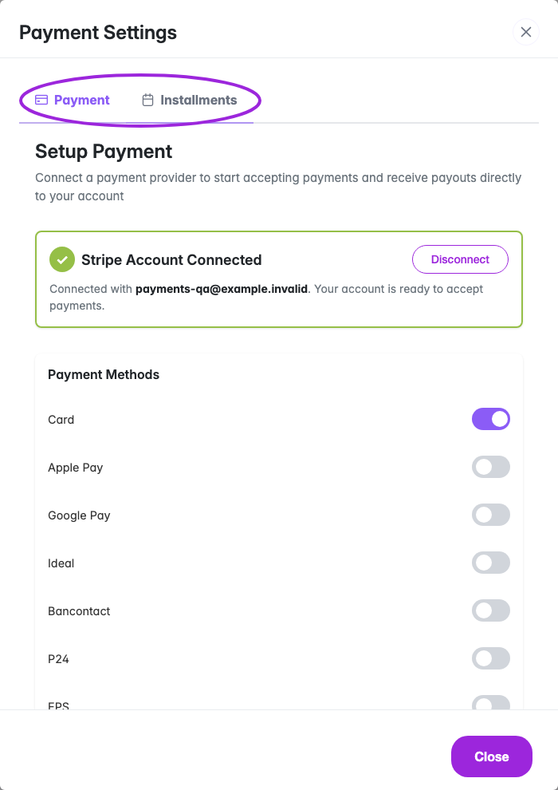
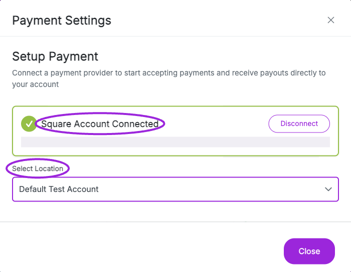

Start with the platform that processes your customer's purchase. Complete its payment setup before selling paid tickets, then check a completed test booking in Ticket Spot and that platform or provider.

## Choose the correct payment workflow

| Where the customer pays | Where to set up payments |
| --- | --- |
| **Shopify checkout** for a linked event product | Configure payments in **Shopify**. Follow the [Shopify quickstart](/plugins/connect-shopify); connecting a provider in Ticket Spot does not replace Shopify's payment setup. |
| **Ecwid checkout** for a published event product | Configure payment methods in **Ecwid**. Follow the [Ecwid quickstart](/plugins/connect-ecwid) and verify the resulting Ticket Spot booking. |
| **Ticket Spot checkout** on Wix, WordPress, Squarespace, an embedded widget, or a hosted event page | Use **Account → Get Paid** in Ticket Spot to connect an available provider as described below. Follow the [website installation guide](/plugins/website-setup) too. |
| **Walk-up sales** | Use the separate [Ticket Spot POS and Square handoff](/on-site/box-office-pos), or its cash workflow. |

Free RSVP does not charge a payment method. For paid checkout, availability depends on the selected provider, account, platform, and plan. The processor controls payment eligibility and payout timing.

If you are unsure which route you installed, open your actual public page and follow the [launch checklist](/getting-started/launch-checklist).

## Connect a Payment Provider

1. Log in to your **Ticket Spot** account, open **Account** in the top navigation, and select **Get Paid** from the dropdown menu.

2. Payment Settings opens on its **Payment** tab, allowing you to connect a payment provider — such as **Stripe**, **Square**, or **PayPal** to start receiving payments for your events.

3. Click **Connect Stripe** (or your preferred provider, such as **Square**, **PayPal**) and follow the on-screen instructions to complete the setup.

After setup, confirm the provider shows as connected and check a completed test purchase in both Ticket Spot and the provider dashboard. Review payout timing and any outstanding verification requirements in the provider account.

<Frame caption="Payment Settings separates provider connections in Payment from collection rules in Installments.">
  
</Frame>

## Connected-provider controls

<Frame caption="Get Paid shows the connected provider. For Square, choose the location used for payments; this Demo account is connected to its test location. Merchant details are concealed.">
  
</Frame>

The controls shown after connection depend on the provider and its account status:

| Provider | Controls in Ticket Spot |
|---|---|
| **Stripe** | **View Account**, connected or **Setup Required** status, and payment-method switches for Card, Apple Pay, Google Pay, Ideal, Bancontact, P24, EPS, and Twint. Select **Save Changes** after editing payment methods. |
| **Square** | Connected-account status and **Select Location**. A location change saves when selected. |
| **PayPal** | PayPal checkout, credit/debit-card fields, and Pay Later switches. Keep at least one method enabled, then select **Save Changes**. Where supported, review account readiness and refresh its status. Card fields require PayPal approval. Older connections may offer **Upgrade PayPal connection**. |

**Disconnect** removes the selected provider connection. Marketplace sites offer Stripe onboarding. A payment-method switch does not guarantee that method is available to every buyer; the provider also determines eligibility.

## Installment payments

- Reusable plans are configured in **Installment Plans** and assigned in **Event → Installment Plan**. Templates support equal splits or percentages, with a deadline before the event and a calculated date when installments stop being offered.
- [Installment tickets](/event-management/installment-payments) require Stripe card checkout. Business includes manual collection; Business Plus and Platform add automatic collection and optional retry days in **Payment Settings → Installments**.

Subscription charges, processor fees, organizer-configured service fees, and marketplace commissions are separate. Review the checkout breakdown and actual provider settlement rather than assuming the ticket's face value is the net payout.
