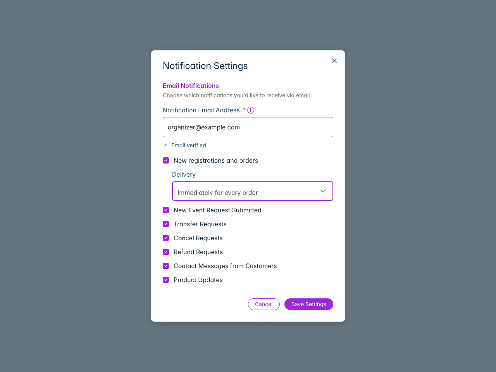
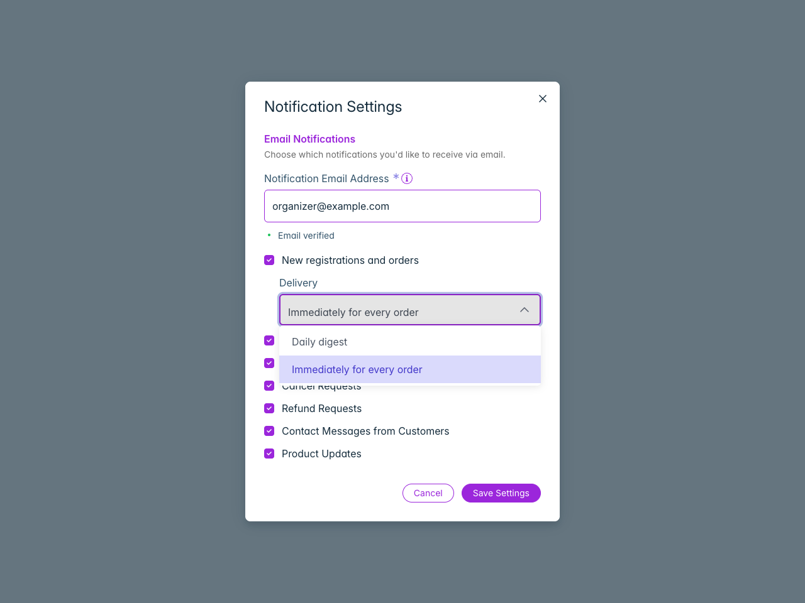
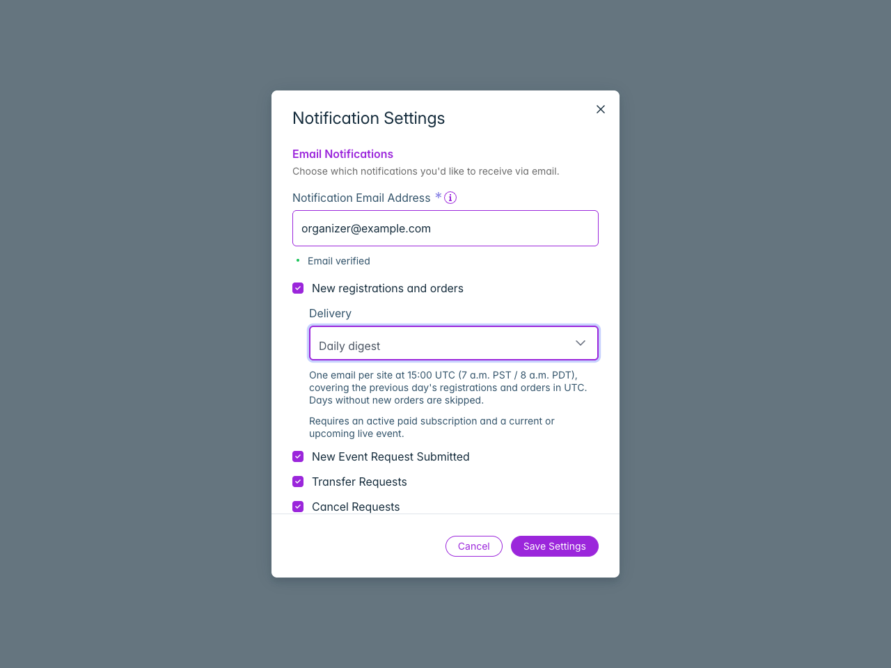
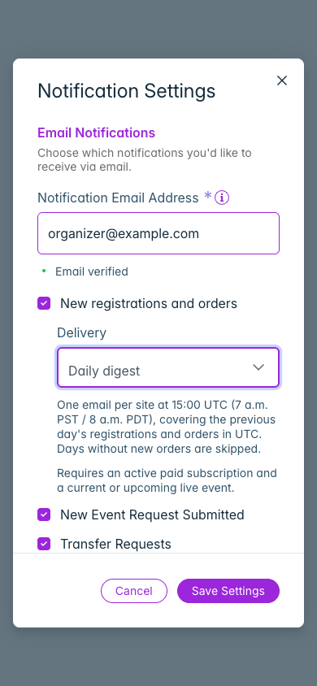
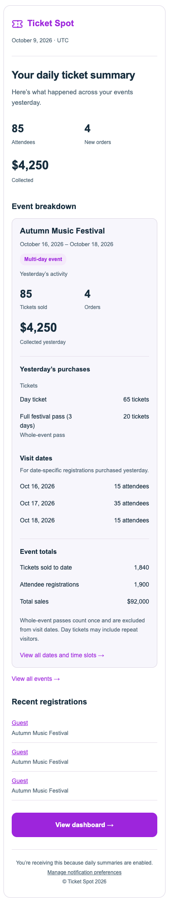
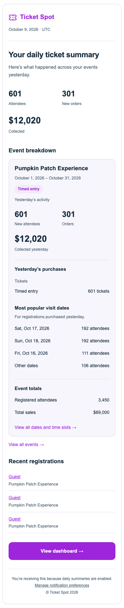
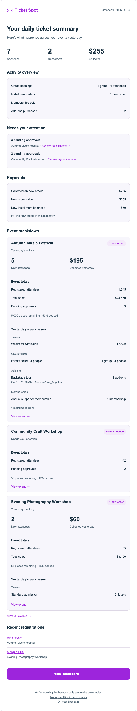
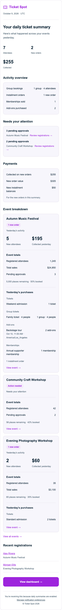

Open **Account → Notifications** to choose the email alerts sent to you as an organizer. These preferences are separate from the [messages sent to attendees](/event-management/email-communication).

## Delivery address and verification

Enter your **Notification Email Address**. When the address is verified, the form shows **Email verified**. An unverified address has a **Verify Email** action; changing the address requires verification again when you save.

Complete the email verification flow when prompted. If you leave the delivery address empty, the settings help text indicates that your account email is used.

<Frame caption="Notification settings with a verified sample organizer address. Choose Save Settings to apply your changes.">
  
</Frame>

## Registration and order delivery

Enable **New registrations and orders**, then choose a **Delivery** option:

| Delivery | What you receive |
|---|---|
| **Daily digest** | One summary per site at 15:00 UTC (7 a.m. PST), covering the previous UTC calendar day's registrations and orders. Days without new orders are skipped. |
| **Immediately for every order** | An organizer email for each new order or registration. |

New accounts default to **Daily digest**. No timezone selection is needed. Existing accounts keep immediate delivery until you change it. Turn off **New registrations and orders** to stop both kinds of organizer order email.

<Frame caption="The Delivery menu offers both daily digests and immediate order notifications. Screenshots use a sample account in a local preview of the dashboard component.">
  
</Frame>

### Daily digest schedule

Choose **Daily digest**, then choose **Save Settings**. Everyone uses the same daily schedule: **15:00 UTC**, covering the previous calendar day in UTC. Delivery normally occurs on the next five-minute scheduler run at or after that time; retries can arrive later.

| Local time | Daily send time |
|---|---|
| Pacific | 7 a.m. PST / 8 a.m. PDT |
| Eastern | 10 a.m. EST / 11 a.m. EDT |
| United Kingdom | 3 p.m. GMT / 4 p.m. BST |

The UTC time stays fixed throughout the year. Saved timezone preferences from an earlier version no longer change the schedule for new digests.

<Frame caption="Daily delivery shows the fixed send time, without a timezone selector.">
  
</Frame>

<Accordion title="Notification settings on a phone">
  <Frame caption="The settings form scrolls while Save Settings and Cancel stay visible.">
    
  </Frame>
</Accordion>

### Which sites receive daily digests?

A site needs an **active paid subscription** and at least one **live current or upcoming event**. A live event with its date still to be determined also qualifies. Free plans, free trials, event packs, disabled sites, demo events, drafts, cancelled events, and deleted events do not qualify.

Eligibility is checked when new registrations are queued and again before a digest is sent. If all your live events have ended before delivery, or your paid subscription is no longer active, the digest is skipped. Registrations made while the site is ineligible are not held for a later digest. Immediate delivery is available separately.

### Your daily ticket summary

The email keeps Ticket Spot's purple and white branding. It opens with yesterday’s **Attendees**, **New orders**, and **Collected**, followed by an event breakdown and a **View dashboard** button. Its subject includes the summary date, and the inbox preview shows your actual activity.

- **Activity overview** shows group bookings and their attendees, installment orders, memberships sold, and add-ons purchased when applicable.
- **Event breakdown** separates yesterday’s new orders, attendees, and collected payments from current **Event totals**. Yesterday’s purchases show ticket and group quantities, add-ons with selected time slots, and memberships. Group quantities count purchases; attendee counts include every member. Membership-only orders appear under their checkout event. Free registrations show new and total attendees without payment rows.
- **Needs your attention** shows current pending approvals. Quiet current/upcoming events needing approval action can appear alongside events with new orders; quiet events needing no action are hidden. **Payments** expands only when new orders have installment balances. Recent registrations link to the corresponding orders.

The account-wide headlines cover yesterday in UTC. **Event totals** show currently approved and checked-in attendees and **Total sales** before discounts, taxes, and fees. Pending approvals are separate. Quiet paid events needing approval action can include known total sales even without yesterday’s payments. Cumulative figures describe the event now, so they can include activity after the summary day; unavailable totals are omitted. Capacity and remaining places stay in the dashboard.

#### Festivals and time slots

A festival, recurring event, or timed-entry attraction appears as **one event card**, even with hundreds of dates or time slots. Ticket types stay together under **Yesterday’s purchases**.

- **Whole-event passes** count once. A three-day pass is one sold pass; it is not repeated under each festival day.
- **Day tickets** show their purchased quantities and visit dates. Festival totals distinguish **Tickets sold to date** from **Attendee registrations**, which can include someone returning on several dates.
- **Group passes** show the number of groups purchased and the people covered, separately.
- **Memberships and add-ons** retain their names and purchase quantities.

Visit dates describe **when the new registrations will attend**, not when the sale happened. For example, tickets bought yesterday for October 25 count in yesterday’s activity and appear under the October 25 visit date. Whole-event passes are excluded from these date-specific rows.

| Event schedule | What the email shows |
|---|---|
| Single-day event | Ticket types |
| Festival/day tickets or recurring event with up to five dates | Individual purchased visit dates |
| Timed entry with up to five slots | Individual purchased dates and times, with timezone |
| More than five dates or slots | **Most popular visit dates**: the top three dates, plus **Other dates** when needed |

The format adjusts automatically to the event's configured schedule. Visit dates use the event's timezone; sales still cover yesterday in UTC. Detailed admissions by festival day and full time-slot reporting remain in the dashboard.

<Accordion title="Festival summary example">
  <Frame caption="Illustrative festival purchases: 20 whole-event passes and 65 day tickets share one card. Only the day registrations appear under visit dates.">
    
  </Frame>
</Accordion>

<Accordion title="Timed-entry summary example">
  <Frame caption="Illustrative purchases across a 301-slot schedule, grouped into the top three visit dates and Other dates.">
    
  </Frame>
</Accordion>

Collected payments and installment balances describe the **new orders in this summary**. They exclude later payments on older orders and are not your total outstanding installment balance. Currencies stay separate. Shared-cart payments count once; an event's collected amount appears only when its orders belong entirely to that event.

<Frame caption="The daily ticket summary uses illustrative purchases to show group bookings, installments, add-ons, memberships, and pending approvals. This is the scheduled email layout.">
  
</Frame>

<Accordion title="Daily ticket summary on a phone">
  <Frame caption="The same scheduled email adapts to a phone. Figures and purchases are illustrative.">
    
  </Frame>
</Accordion>

The email shows at most **eight event cards** after grouping their dates and slots, prioritizing approval action and then new order volume, with **View all events** for the rest. Additional purchases link to the dashboard; the headline metrics still include all accessible orders. Each eligible organizer receives a digest for events they can access. Payments and memberships from shared orders containing inaccessible events are omitted from that organizer's totals. Event-scoped managers receive cumulative attendee counts only when the full event scope is accessible; cumulative sales are omitted to protect historical shared-order details. Turning notifications off or losing access prevents pending digest delivery.

These settings control **organizer alerts**. They do not delay attendee confirmation emails or change your [attendee email campaigns](/event-management/email-communication).

## Available notifications

| Preference | Alert |
|---|---|
| **New registrations and orders** | New registrations and orders, delivered daily or immediately according to your selection. |
| **New Event Request Submitted** | Events submitted for organizer review. |
| **Transfer Requests** | Attendee transfer requests. |
| **Cancel Requests** | Attendee cancellation requests. |
| **Refund Requests** | Attendee refund requests. |
| **Contact Messages from Customers** | Messages customers send to the host. |
| **Product Updates** | Ticket Spot product updates and announcements. |

Select the alerts you want, then choose **Save Settings**. **Cancel** closes the form without applying those edits.
