Open an event's **Attendees** page and choose **Seating Chart** to manage its seating assignments. This view connects the map to existing attendee registrations. To register a new guest, use [Add Attendee](./adding-attendees-manually) first.

Before you start, enable seating on the event and [assign a published chart](../seating-charts/create-and-assign). Your team role must allow attendee management. Seat bookings also require available [Seating Credits](../account/billing-and-plans).

## Open the correct event date

1. Open **Events**, find the event, and choose **Attendees**.
2. Select **Seating Chart**.
3. For recurring or timed events, choose **Event Date** and **Time Slot** when shown. Each occurrence has its own seating availability and attendee assignments.
4. Check **Seat Summary**: total **Seats**, **Booked**, and **Available**. Seats reserved without an attendee also affect availability.
5. Use the map's zoom, search, floor, and section controls to locate the area you need. Select a seat or standing area to open its details.

Changing the occurrence clears your selection and any unfinished order-assignment shortcut. **Clear Selection** clears the map selection without changing saved bookings. The modal can be maximized; the map also has its own full-screen control when offered.

<Frame caption="The organizer seating view combines the map, date selection, Seat Summary, and Seat Details.">
  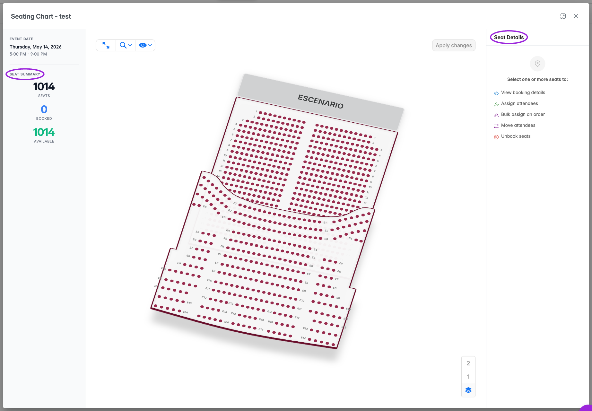
</Frame>

## What you can do

| Action | Result |
| --- | --- |
| **Assign Attendee** | Links an existing attendee to one reserved seat or one place in a standing area. |
| **Confirm Reassignment → Reassign** | Moves an attendee who already has an assignment. Review the old and new labels before confirming. |
| **Assign … Seats to Order** | Pairs several selected reserved seats with attendees from an order, then shows a review before saving. |
| **Assign Individual Seats** | Expands the individual controls within a multiple-seat selection. |
| **Assign Remaining** | Continues an order that still has attendees without seats after a partial assignment. |
| **Remove from Area** | Removes one selected GA attendee and releases one standing place. Other occupants stay assigned. |
| **Unbook Seat** | Removes a reserved-seat assignment after confirmation. |
| **Block Seat / Block … Seats** | Reserves the selected seats without attaching attendees. |
| **Unblock Seat / Unblock … Seats** | Releases the selected seats; existing attendee assignments can be removed. |

## Assign or reassign one attendee

For individually reserved seats, **Seat Details** shows one of these states:

| State | Meaning |
| --- | --- |
| **Available** | The seat is free and has no linked attendee. |
| **Assigned** | An attendee is linked to this seat. Review their name and ticket. |
| **Blocked** | The map shows a booking without a linked attendee, such as an organizer reservation. |

1. Select an available seat and choose **Assign Attendee**.
2. Type at least two characters of the attendee's name or email in the search field.
3. Leave **Only unassigned** selected to find guests without assignments. Clear it to search for someone who already has a seat or area assignment.
4. Choose the attendee and **Assign**.
5. If the attendee already has an assignment, review **Confirm Reassignment** and choose **Reassign** to move them. Canceling leaves their original assignment unchanged.
6. Verify the attendee and the destination on the refreshed map.

An individually reserved seat already assigned to someone else cannot be claimed through this single-attendee action. Unassign its current occupant first, or use the order-assignment review when you deliberately need to move people between selected reserved seats.

<Frame caption="Search for an attendee and use Only unassigned to control whether already-seated guests are included.">
  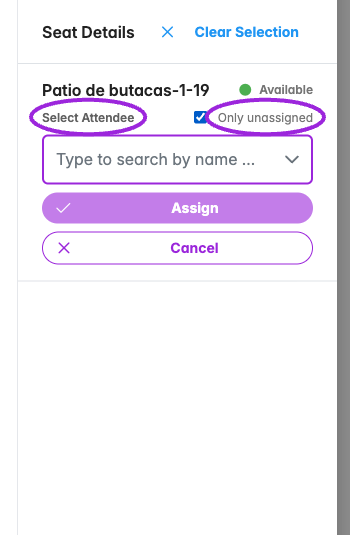
</Frame>

## Assign attendees to standing general admission

A standing GA area contains multiple places. Several attendees can share the same area label; that does not mean they share an individually reserved seat. The area panel shows available places and **Attendees in this area**.

1. Select the standing area on the map.
2. Choose **Assign Attendee**, search by name or email, select the guest, and choose **Assign**.
3. Repeat for the next guest. Each assignment uses one place, and existing occupants stay assigned.
4. Check the attendee list and the remaining available places. Assignment is disabled when the area is full; remove or move a guest, or choose another area.

The standing-area screenshots below use synthetic attendees and booking data in a local demo. Your map, names, and available capacity will differ.

<Frame caption="An empty standing area offers attendee assignment. The panel explains that every assignment uses one place.">
  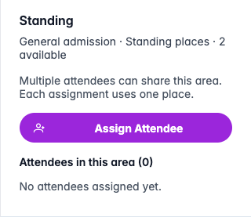
</Frame>

<Frame caption="After one assignment, Assign Attendee remains available for the next guest.">
  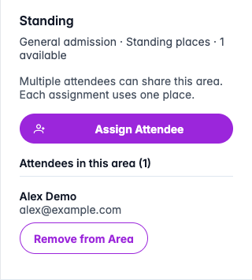
</Frame>

<Frame caption="Two guests share this standing area. Each person has a separate removal action; the area is now full.">
  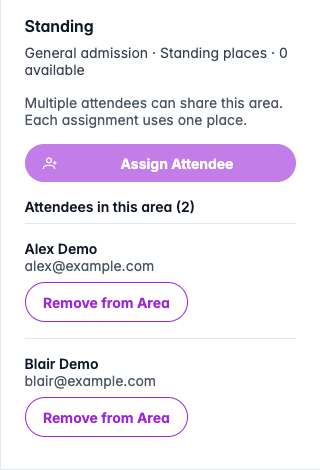
</Frame>

### Move a guest into or out of GA

To move an already-assigned guest into a standing area, clear **Only unassigned**, find them, and choose **Assign**. **Confirm Reassignment** names their current assignment and the destination. Confirm only after checking both labels.

To move a GA guest to an individually reserved seat, select the destination seat and use the same individual assignment flow with **Only unassigned** cleared. Standing-area moves are managed individually; the reserved-seat order-assignment action does not move guests into or out of GA.

<Frame caption="The local demo moves Casey Demo from reserved seat A1 into Standing after explicit confirmation.">
  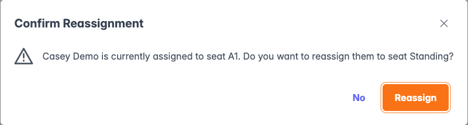
</Frame>

### Remove one guest from the area

Choose **Remove from Area** beside the person, review their name and area in the confirmation, and choose **Remove**. This releases one place. Other attendees remain in the area, and the removed person's registration remains valid. Removing an area assignment does not cancel the registration or refund the order.

<Frame caption="Removal identifies one guest and explains that their ticket remains valid.">
  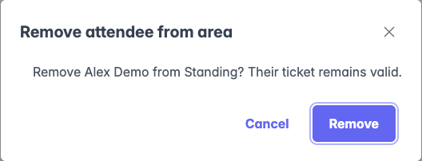
</Frame>

### Whole-area reservations

Some areas are sold as one exclusive reservation, such as a section for a group. They retain the single-assignment controls. A capacity or group size in an area's label does not make it standing GA: the chart's booking setup determines whether organizers assign separate places or the entire area.

## Assign several reserved seats to an order

1. Select several individually reserved seats. The sidebar summarizes their rows, sections, and assignment state.
2. Choose **Assign … Seats to Order** and search by attendee or buyer name or email.
3. Choose the order and inspect **Review Seat Assignment**.
4. Review **Currently seated**, **After assignment**, and **Still unseated**. Selected seats are paired in chart order with attendees in purchase order.
5. Review every proposed pairing before confirming.

| Review label | What to check |
| --- | --- |
| **Will assign** | The attendee will receive this seat. |
| **Moving seat** | The attendee already has a reserved seat and will move. Check the current and destination labels. |
| **Ticket mismatch** | The ticket does not match the selected seat's category. Acknowledge the mismatch before confirming if the assignment is intentional. |
| **Conflict** | Someone outside the pairing currently occupies the seat. Confirmation can unseat that person. |
| **Stays empty** | No attendee is paired to this selected seat. |

Not-attending and waitlisted attendees are excluded unless you explicitly include them in the review. For individual changes within a selection, expand **Assign Individual Seats**.

<Frame caption="A multiple-seat selection exposes order assignment and individual-seat controls.">
  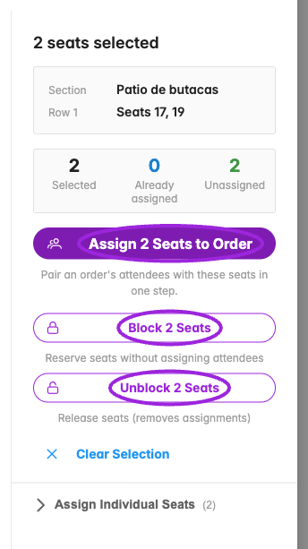
</Frame>

<Accordion title="Order search, review, and saved result">
  <Frame caption="Choose the matching order and check its ticket count.">
    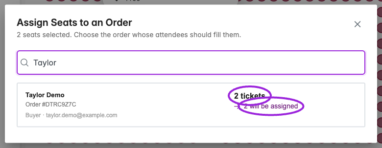
  </Frame>
  <Frame caption="Review the proposed pairings and before-and-after totals.">
    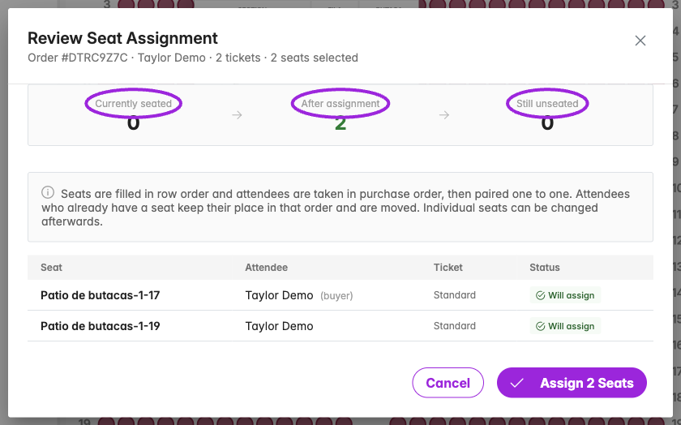
  </Frame>
  <Frame caption="Seats Assigned confirms the saved result.">
    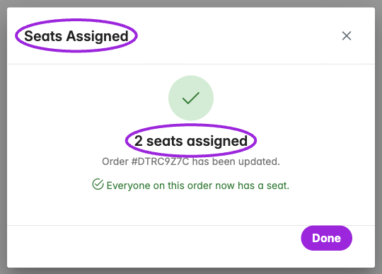
  </Frame>
</Accordion>

After confirming, inspect **Seats Assigned**. If guests remain unseated, choose **Select More Seats**, select the next reserved seats, and use **Assign Remaining**. If some saves fail, review the affected seats before continuing. Closing the review or modal does not undo assignments that have already saved.

## Block, unblock, and unbook

For one available reserved seat, use **Block Seat** to reserve it without an attendee. For a blocked seat, use **Unblock Seat** to release it. A blocked seat can also show **Assign Attendee** so you can attach an attendee to the reservation.

For multiple selected reserved seats, use **Block … Seats** or **Unblock … Seats**. These actions submit immediately. **Unblock** can remove linked attendee assignments, so review the entire selection before using it.

For an assigned reserved seat, choose **Unbook Seat**, review **Confirm Unbook**, and confirm to release that person's seat. Unbooking is separate from canceling or refunding the order. For standing GA, use the person's **Remove from Area** action instead.

<Frame caption="An assigned reserved seat shows the attendee, ticket, and Unbook Seat action.">
  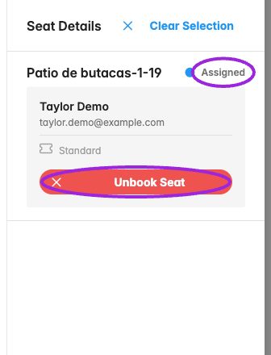
</Frame>

When the map offers its own **Apply changes** control, a successful save refreshes statistics and clears the selection. Use the attendee assignment controls to link existing registrations to seats.

## Mobile and unavailable actions

On a narrow screen, the map sits above the attendee panel. Scroll down to search, assign, and review people in a standing area. Use **Clear Selection** to return to an empty selection without changing saved assignments.

<Frame caption="The mobile standing-area panel keeps both attendees and their individual removal controls within the screen width.">
  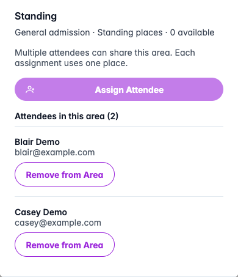
</Frame>

If assignment is unavailable, check remaining places, Seating Credits, and the selected event date. Seating allowance, event capacity, and ticket inventory are separate limits. Increasing ticket inventory does not add Seating Credits. A chart replacement can also pause seating until it is resumed or restored in the event's ticket settings.

If an area is fully booked, the assignment warning names the area and asks you to review its reservations or choose another area. A release shown on the map, such as **-1**, is still pending until you save it with **Apply changes**. Review the reservation you intend to release, apply the map changes, and then try the assignment again. Selecting a booked area does not by itself make another place available.

When attendee details fail to load, select the area again to retry. After an assignment error, verify the guest's current assignment before trying again. A full destination must not cause you to remove the guest's original place first.

For chart setup and buyer pricing, see [Seat selection and attendee assignment](../seating-charts/seat-selection). For registration status or payment changes, use [Attendee management](./managing-attendees) and [Refunds and cancellations](./refunds-and-cancellations).
