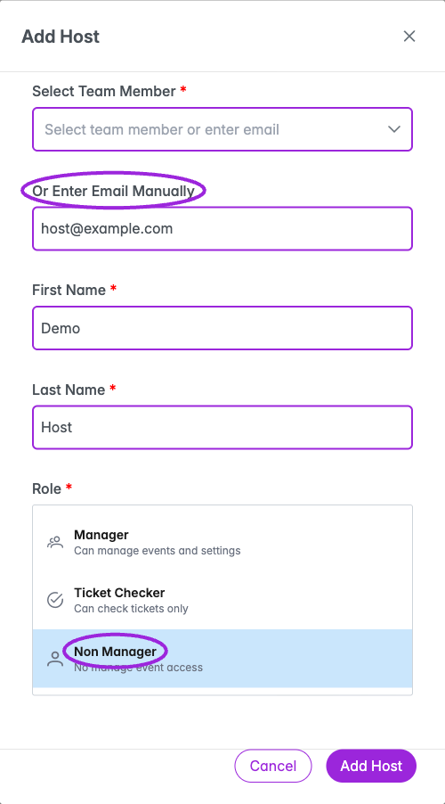

Open **Events → Edit event → Hosts**. Event hosts can help manage this event, check tickets, or appear publicly when host display is enabled. Event roles are separate from site-wide team access.

## Event hosts

Event invitations apply to this event. A site-level team role is separate: someone who already has Admin or Manager access to the site keeps that access when added as a host.

## Invite a host

1. Under **Manage Hosts**, click **Add Host**.
2. Choose **Select Team Member**, or use **Or Enter Email Manually**.
3. Complete **First Name** and **Last Name**.
4. Select the appropriate **Role**.
5. Click **Add Host** to send the event invitation. It appears under **Pending Invitations** until accepted; it does not immediately become an active host.

<Frame caption="Choose a site team member or enter a name and email, then select this event’s role. Manager, Ticket Checker, and Non Manager provide different levels of event access.">
  
</Frame>

| Role | Event access |
|---|---|
| **Manager** | Can manage the event and its settings. |
| **Ticket Checker** | Can scan tickets for this event. No revenue, sales reports, orders, attendee dashboard, full attendee list, exports, or event settings. Scan results show the first name and last initial, ticket type, and check-in result. |
| **Non Manager** | Has no dashboard or scanning access from this invitation. Can appear as a public host when host display is enabled. |

## Check in as a Ticket Checker

After accepting the invitation, sign in and select the event’s site. Only events assigned to you appear. Select **Scan tickets** on an event card, then scan a ticket using a USB or Bluetooth scanner in keyboard mode, or enter its code. You can also use the Ticket Spot mobile app.

The scanner displays the admission result and the ticket details needed for check-in. It does not open the attendee dashboard or reveal email addresses, phone numbers, order totals, ticket prices, or revenue. A ticket for an event you are not assigned to is rejected. For a recurring event, the assignment also covers its booked dates.

Ticket Checkers use online scanning. Full offline attendee-list downloads and name-based attendee browsing are not available to this role.

For a checkpoint event, an owner or administrator must assign the checkpoint before scanning.

## Active members

Select **Active Members** to see accepted, active hosts and their role badges. Use the pencil icon to edit a host's **First Name**, **Last Name**, or **Role**, then choose **Save Changes**. The email address is read-only.

Use the remove icon and confirm to remove an eligible host from the event. The event owner's row does not offer removal. Removing an event host does not revoke separate site-team permissions they may hold.

## Pending invitations

Select **Pending Invitations** to inspect invitations awaiting acceptance. Open a row's actions menu to **Resend Invitation** or **Delete** it. Resending sends another invitation email; deleting asks for confirmation.

## Show hosts to attendees

Configure host visibility in [Event Page design](../branding-and-design/event-page-design) and [Widget Display settings](../branding-and-design/widget-display-reference). Use this event's [Display Settings](./display-settings) to override its host name, logo, and Meet the Host content.

For site-wide collaborators, use [Invite Team](../team/invite-team-roles).

## Assign an event checkpoint

For the checkpoint release, owners and administrators can select a checkpoint below **Role** in an event host invitation or edit an active host's assignment. The assignment appears when **Ticket Checker** is selected. Changing the host to another role clears the checkpoint assignment when saved. See [Ticket checkpoints](/on-site/ticket-checkpoints) for the release prerequisites and illustrated workflow.
