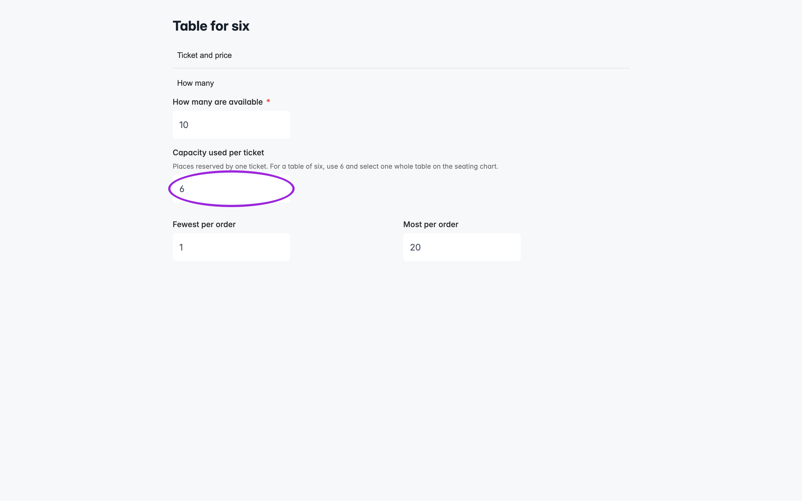
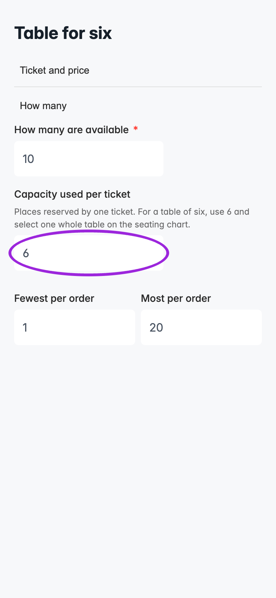
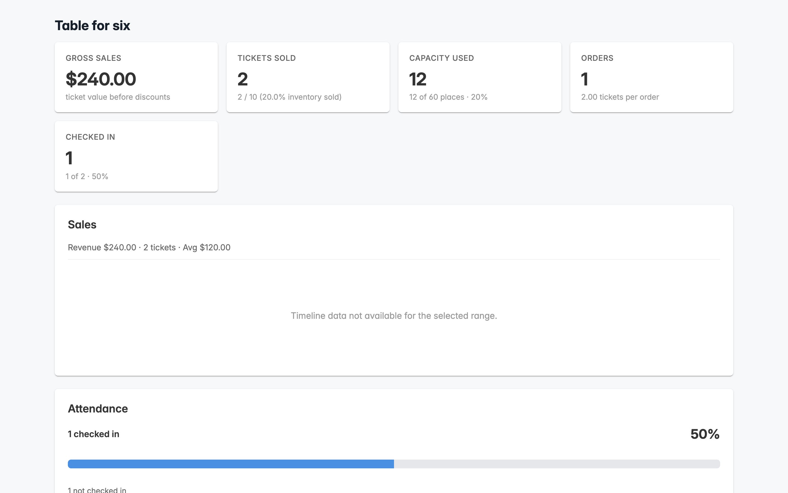

**Capacity used per ticket** controls how many event places one purchased ticket reserves. It defaults to **1**. Use **6** for a ticket admitting a table of six, or **4** for a four-person booth.

## Set up a table ticket

1. Set the event's capacity to the number of people it can accommodate.
2. Create an ordinary ticket named **Table for six**. Set its price to the price of the entire table.
3. Under **Sales & Capacity**, set **Capacity used per ticket** to **6**. In the custom day editor, open **How many**.
4. Set ticket inventory to the number of tables offered. Minimum and maximum quantities per order are also numbers of tables.
5. Save and preview checkout.

<Frame caption="Capacity used per ticket in the custom day editor. This local demonstration renders the real editor with synthetic data.">
  
</Frame>

<Accordion title="View the capacity setting on mobile">
  <Frame caption="The same capacity setting on a mobile-sized screen, using synthetic demo data.">
    
  </Frame>
</Accordion>

With a $120 ticket, buying two tables charges $240, uses two inventory units, and reserves twelve event places. It creates two attendee records and two tickets for check-in. Use a **group ticket** when you need separate attendee records for the people in a bundle; group capacity comes from its composition and the manual capacity field is disabled.

## Seating charts

For a whole table, set the chart object to **Book by table**, publish the chart, and assign its category to the table ticket. The buyer selects one table object for each purchased table ticket. Setting capacity to six does not select six chairs automatically.

For a booth, map its bookable object to the booth ticket and set the ticket's capacity to the number of people admitted. For individual chairs, use **Book by seat** and normally leave capacity at one. See [whole tables and booths](/seating-charts/advanced-layouts).

Selections across all categories share the event's place budget. Ticket stock and per-order limits still apply. A buyer cannot select more objects than the chosen tickets permit or switch an object's ticket type if the resulting selection exceeds available places.

Ticket Spot's seating selection count follows the booked objects; changing the capacity field does not multiply the selected objects or their ticket price. Existing reservations remain attached to their original objects.

## Availability, dates, and add-ons

The number of tickets available is the smaller of remaining ticket inventory and the event's remaining places divided by capacity per ticket, rounded down. With ten places left, only one six-place table is available even if several tables remain in inventory. Different ticket types share those ten places; their individual availability cannot be added together.

Custom date tickets keep their own setting. Dates using event defaults inherit their ticket configuration while using the selected date's availability. Add-ons use the chosen date or time slot's tickets and capacity, including their minimum and maximum quantities.

Waitlist purchase allowances are ticket quantities. An allowance of two table tickets permits up to twelve places when capacity is six. Link invitations do not reserve places; availability is checked when the guest purchases. Pending registrations and paid orders held because of plan limits still reserve their event places.

## Analytics and existing bookings

**Capacity Used** reports reserved places. **Tickets Sold**, **Checked In**, and monetary figures retain their existing ticket, attendee, scan, and currency units.

<Frame caption="Two $120 table tickets use twelve places. This local demonstration renders the real analytics component with synthetic data.">
  
</Frame>

The capacity of a booking is saved when it is issued. Editing a ticket's setting affects future purchases; it does not resize existing bookings. Historical bookings without a saved capacity setting continue to use one place. Cancelling attendance releases its reserved places; refunding payment alone does not cancel attendance.

A replacement ticket uses its new capacity and checks additional required places before the change. Moving an attendee to another event without replacing the ticket preserves the issued capacity. A same-ticket seat change also preserves the issued capacity. Self-service seat changes remain limited to eligible individual seats; contact the organizer to move a whole table or booth.
