Use this tour to find your way around the Ticket Spot dashboard. For a guided setup, [choose your website](/getting-started/start-here), then follow the [first-event guide](/getting-started/first-event) and [launch checklist](/getting-started/launch-checklist).

## Explore the dashboard

<iframe 
width="100%" 
height="400" 
src="https://www.youtube.com/embed/Rxd7gFCTVpg?si=j4-coC1GeWatVHgE" 
title="YouTube video player" 
frameborder="0" 
allow="accelerometer; autoplay; clipboard-write; encrypted-media; gyroscope; picture-in-picture;" 
allowfullscreen>

</iframe>

Choose the site you want to manage, then use the top navigation to move between Events, Analytics, Memberships, Seat Charts, Design, Integrations, Settings, and Invite Team.

<Frame caption="Choose your site from the top-left menu, then use the navigation tabs to open each area.">
  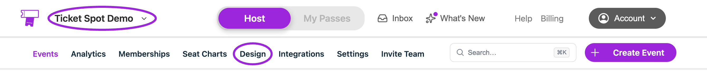
</Frame>

## Start with your brand

Set your [brand colors and logo](../branding-and-design/brand-design) before creating a widget or customizing emails. Basic brand identity is available on **all plans**. Continue through the [Design setup guide](../branding-and-design/design-overview) to review each attendee-facing surface.

<Frame caption="Open Design → Brand to upload a logo and choose your primary color. The preview shows how the selected brand appears.">
  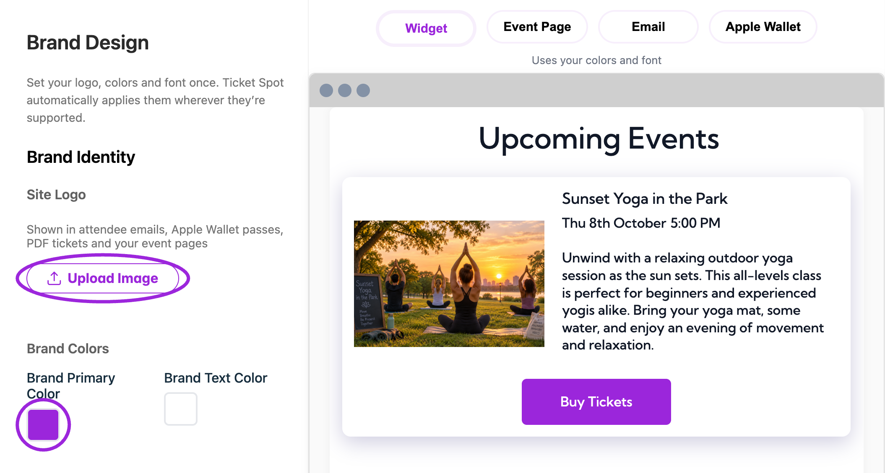
</Frame>

## Memberships

Use [memberships and annual passes](../memberships/overview) for admission across assigned events, class packages, members-only tickets, or special member prices. The Memberships tab also shows the people assigned and their visit/expiry details.

<Frame caption="In Memberships, create a membership and review Pricing, Access Rules, and assigned Events. This example shows a $99 one-year pass.">
  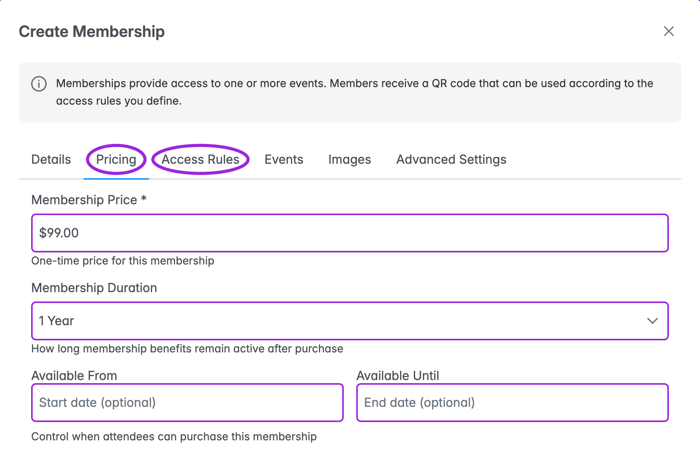
</Frame>

## Event Management

Everything you need to build, edit, and organize your events—from setup to launch.

| Functions               | Description                                             | Reference |
|------------------------|---------------------------------------------------------|-----------|
| **Create Events**          | Learn how to create a new event using all event builder steps | [Create Events guide](../event-management/create-event-overview)  |
| **Event Details**          | Add event title, description, categories, and visibility | [Event Details guide](../event-management/eventdetails)  |
| **Dates & Times**          | Set schedule, recurring dates, and timezones            | [Dates & Times guide](../event-management/datetime)  |
| **Venue & Location**       | Add venue details, maps, and location visibility        | [Venue & Location guide](../event-management/venuelocation)  |
| **Ticket Setup**           | Create ticket types, pricing, availability, and rules   | [Ticket Setup guide](../event-management/ticket-setup)  |
| **Email Communication**    | Configure confirmation and reminder emails              | [Email Communication guide](../event-management/email-communication)  |
| **Waitlist**               | Enable and manage event waitlist logic                  | [Waitlist guide](../event-management/waitlist)  |
| **Additional Information** | Collect custom attendee information fields              | [Additional Information guide](../event-management/additional-information)  |
| **Checkout Complete**      | Customize the confirmation page message                 | [Checkout Complete guide](../event-management/checkout-complete-message)  |
| **Tags & Custom Fields**   | Use tags and custom fields for filtering and automation | [Tags & Custom Fields guide](../event-management/tags-and-custom-fields) |
| **Hosts**                  | Add event hosts and display them on your event page     | [Hosts guide](../event-management/hosts)  |
| **Display Settings**       | Control how events appear publicly                      | [Display Settings guide](../event-management/display-settings)  |
| **Manage Events**          | View and edit all your events in one dashboard          | [Manage Events guide](../event-management/manage-events)  |

<Frame caption="Choose Manage event to edit the event, or Open dashboard to manage its attendees.">
  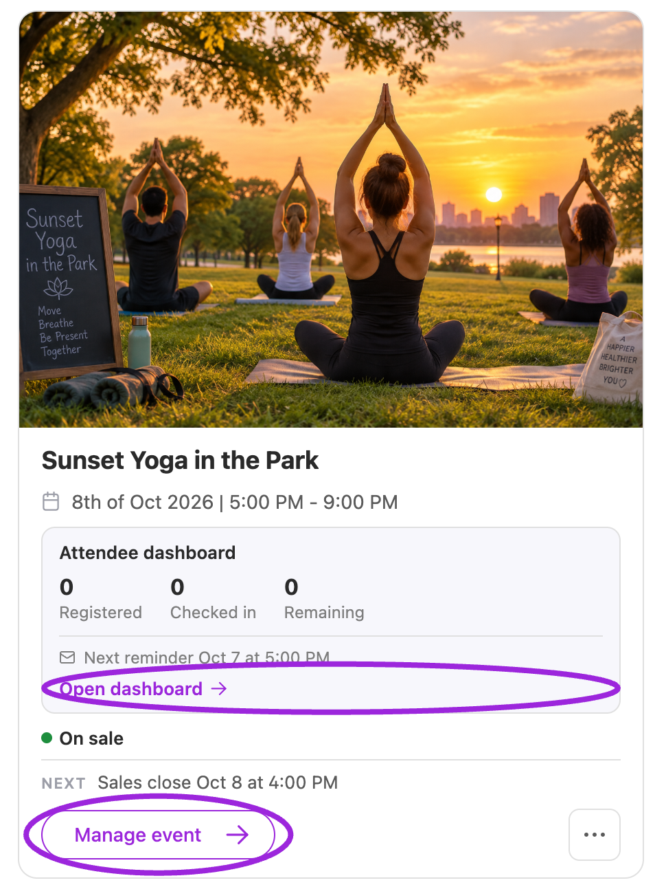
</Frame>

## Analytics

Understand event performance through clear visual insights, revenue breakdowns, and engagement patterns.

| Functions                 | Description                                            | Reference |
|---------------------------|--------------------------------------------------------|-----------|
| **Analytics Overview**        | Summary of analytics modules and insights             | [Analytics Overview guide](../analytics/analytics-overview)  |
| **Sales Analytics**           | View revenue, orders, ticket sales, and refund stats  | [Sales Analytics guide](../analytics/sales-analytics)  |
| **Check-in Analytics**        | Track check-ins and real-time attendance activity     | [Check-in Analytics guide](../analytics/check-in-analytics) |
| **Abandoned Cart Analytics**  | Analyze dropped carts and recovery opportunities      | [Abandoned Cart Analytics guide](../analytics/abandoned-cart-analytics)  |
| **Event View Analytics**      | Track impressions, page visits, and viewer engagement | [Event View Analytics guide](../analytics/event-view-analytics)  |

<Frame caption="Select an event and date range, then switch between Overview, Sales, Attendance, Traffic, Abandoned Carts, and Email.">
  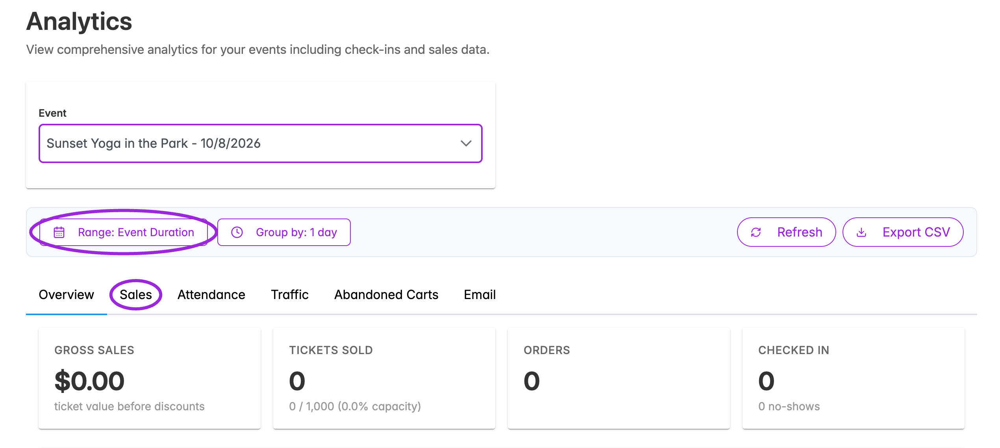
</Frame>

## Attendee Management

Your central place to review attendee records, update information, and keep your event data organized.

| Functions                 | Description                                | Reference |
|---------------------------|--------------------------------------------|-----------|
| **Viewing Attendee Details**  | View complete attendee information         | [Viewing Attendee Details guide](../attendee-management/viewing-attendee-details)  |
| **Managing Attendees**        | Update attendee details and manage participation | [Managing Attendees guide](../attendee-management/managing-attendees)  |
| **Adding Attendees Manually** | Add attendees without checkout flow        | [Adding Attendees Manually guide](../attendee-management/adding-attendees-manually)  |
| **Export Attendees & Check-In Data** | Export full attendee and check-in reports | [Export Attendees & Check-In Data guide](../attendee-management/export-attendees-and-check-in-data)  |

<Frame caption="Use Add Attendee for a manual registration, search or filter the list, and use Export for a report. Personal details are concealed in this example.">
  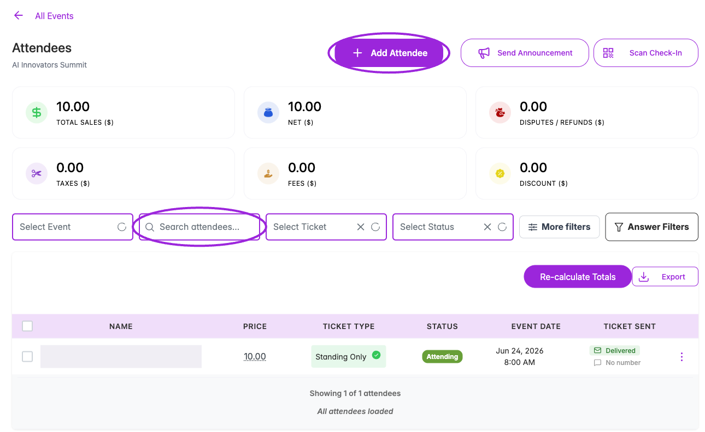
</Frame>

## Attendee Portal

This section explains the tools attendees use to access and manage their tickets and event information.

| Functions                 | Description                                | Reference |
|---------------------------|--------------------------------------------|-----------|
| **Viewing Your Tickets**      | Access purchased tickets and event info    | [Viewing Your Tickets guide](../attendee-portal/viewing-your-tickets)  |
| **QR Codes & Digital Wallets**| Save tickets to Apple/Google Wallet        | [QR Codes & Digital Wallets guide](../attendee-portal/qr-code-digital-wallets)  |
| **View Receipt & Download PDF** | Download order receipts                  | [View Receipt & Download PDF guide](../attendee-portal/view-download-receipt)  |
| **Cancel or Transfer Event**  | Cancel or transfer registrations           | [Cancel or Transfer Event guide](../attendee-portal/cancel-transfer-event)  |
| **Contact Host**              | Contact event organizers from portal       | [Contact Host guide](../attendee-portal/contact-host)  |

<Frame caption="Attendees can view their QR code, download documents, and contact the host. This built-in preview shows the available sections; hosts control their visibility in Design → Attendee Ticket Page.">
  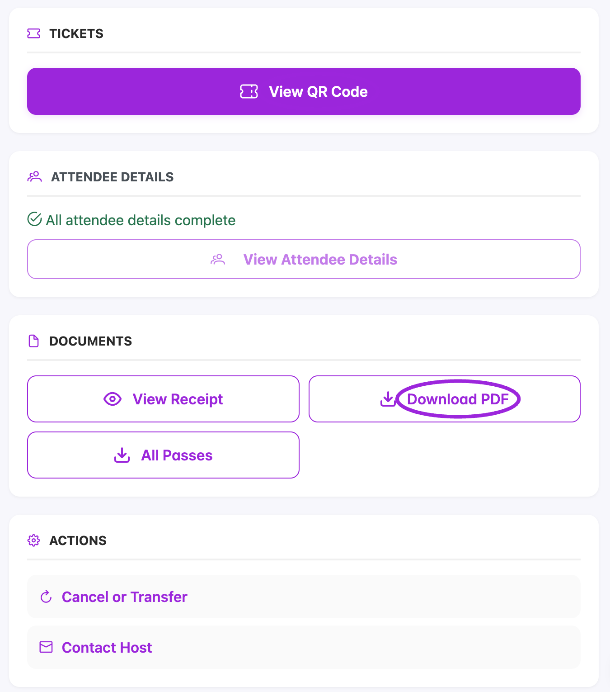
</Frame>

## Mobile App

On-site features that help your team scan tickets, manage check-ins, and track attendees in real time.

| Functions            | Description                               | Reference |
|----------------------|-------------------------------------------|-----------|
| **Mobile App Overview**  | Overview of the Ticket Spot mobile app | [Mobile App Overview guide](../mobile-app/mobile-app-overview)  |
| **Mobile Check-in**      | Scan attendee QR codes for entry           | [Mobile Check-in guide](../mobile-app/mobile-check-in)  |
| **Attendee Details**     | View attendee details in the app           | [Attendee Details guide](../mobile-app/attendee-details)  |

<Frame caption="From Events → View activity, choose Check In Attendees. Use the mobile installation QR codes or links for iOS and Android, or start desktop check-in.">
  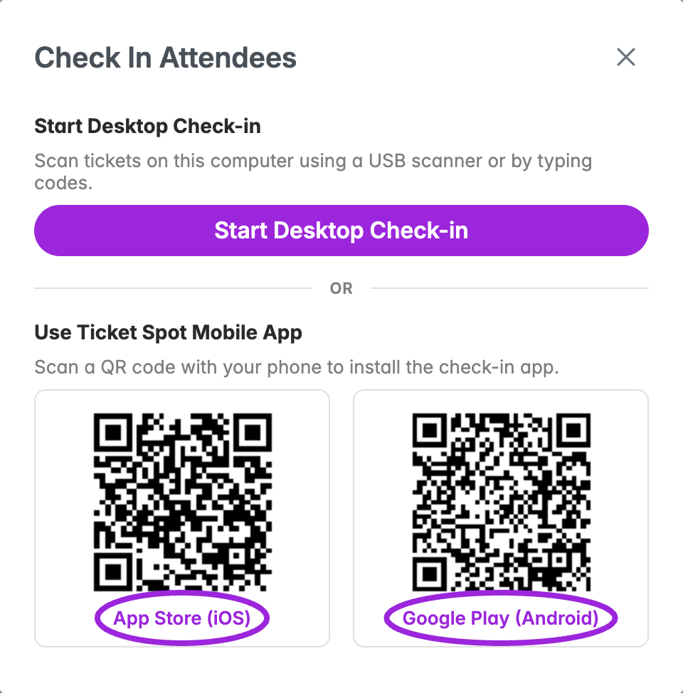
</Frame>

## Branding and Design

Everything you need to customize your Event Hub’s visual identity, layouts, and ticket/receipt designs.

| Functions                 | Description                                | Reference |
|---------------------------|--------------------------------------------|-----------|
| **Brand Design**              | Upload logos and configure branding        | [Brand Design guide](../branding-and-design/brand-design)  |
| **Site Design**               | Customize the layout of your Event Hub site | [Site Design guide](../branding-and-design/site-design)  |
| **Event Page Design**         | Configure event page layout and hero section | [Event Page Design guide](../branding-and-design/event-page-design)  |
| **Widget Customization**      | Customize ticket widget styles             | [Widget Customization guide](../branding-and-design/widget-customization-overview)  |
| **Quick Settings** | Adjust common widget options and open All Settings | [Quick Settings guide](../branding-and-design/quick-settings) |
| **Attendee Ticket Page** | Control ticket, document, and attendee actions | [Attendee Ticket Page guide](../branding-and-design/attendee-ticket-page) |
| **Ticket & Receipt Attachment** | Customize PDF ticket and receipt templates | [Ticket & Receipt Attachment guide](../branding-and-design/ticket-and-receipt-attachment-design)  |
| **Attendee Communication**    | Customize email templates sent to attendees | [Attendee Communication guide](../branding-and-design/attendee-communication-design)  |

<Frame caption="Open Design → Widget. Start in Quick Settings, use View all layouts for layout choices, or open All Settings for the complete set of controls.">
  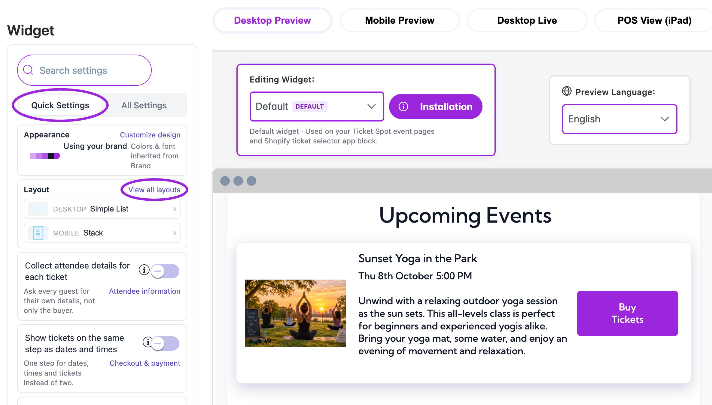
</Frame>

<Accordion title="Watch: open All Settings (7 seconds)">
  <picture>
    <source media="(prefers-reduced-motion: reduce)" srcSet="../assets/refresh/getting-started/platform-widget-tour-poster.png" />
    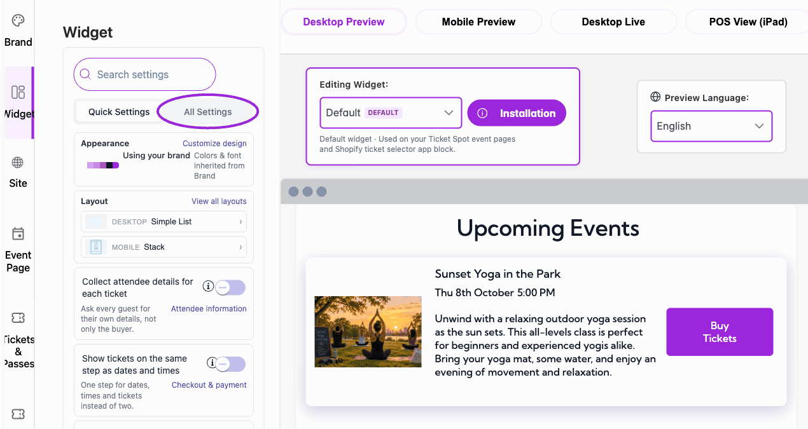
  </picture>

  In **Design → Widget**, choose **All Settings** beside **Quick Settings** to browse every category. [View the static image](../assets/refresh/getting-started/platform-widget-tour-poster.png).
</Accordion>

## Integrations

Connect Ticket Spot with other platforms to sync events, automate workflows, and enhance your setup.

<Frame caption="In Integrations, find Event Platforms and choose View Details or Connect for the service you want to use.">
  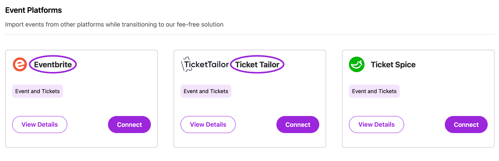
</Frame>

### Event Platform Integrations

| Functions              | Description                                 | Reference |
|------------------------|---------------------------------------------|-----------|
| **Eventbrite Integration** | Import Eventbrite events and registrations  | [Eventbrite Integration guide](../integrations/eventbrite)  |
| **Ticket Tailor Integration** | Sync Ticket Tailor events                | [Ticket Tailor Integration guide](../integrations/tickettailor)  |
| **Ticket Spice Integration** | Import TicketSpice events                | [Ticket Spice Integration guide](../integrations/ticketspice)  |

### Virtual Event Integrations

| Functions           | Description                    | Reference |
|---------------------|--------------------------------|-----------|
| **Google Integration**  | Sync Google events and data    | [Google Integration guide](../integrations/google)  |
| **Zoom Integration**    | Auto-create and sync Zoom meetings | [Zoom Integration guide](../integrations/zoom)  |

### Live Streaming Integration

| Functions          | Description                          | Reference |
|--------------------|--------------------------------------|-----------|
| **Twitch Integration** | Embed Twitch livestreams into event pages | [Twitch Integration guide](../integrations/twitch) |

### Marketing Automation

| Functions           | Description                             | Reference |
|---------------------|-----------------------------------------|-----------|
| **Zapier**              | Automate workflows and event triggers   | [Zapier guide](../integrations/zapier)  |
| **Mailchimp Transactional** | Configure transactional email templates and delivery     | [Mailchimp Transactional guide](../integrations/mailchimp)  |
| **Klaviyo Integration** | Sync attendee profiles and ticket activity | [Klaviyo Integration guide](../integrations/klaviyo) |

## Site Settings

Controls that let you manage your site’s configuration, domain, tracking, and multi-site operations.

| Functions           | Description                              | Reference |
|---------------------|------------------------------------------|-----------|
| **Site Setting**        | Configure your Event Hub settings        | [Site Setting guide](../site-settings/site-settings)  |
| **Domain & Analytics**  | Add custom domain and tracking scripts   | [Domain & Analytics guide](../site-settings/domain-and-analytics)  |
| **Mobile Check-in**     | Configure staff check-in options         | [Mobile Check-in guide](../site-settings/mobile-check-in)  |
| **Event Submissions**   | Enable public event submission           | [Event Submissions guide](../site-settings/event-submissions)  |
| **Add & Switch Sites**  | Manage multiple hubs under one account   | [Add & Switch Sites guide](../site-settings/add-and-switch-sites)  |

<Frame caption="Open Settings to configure domains, sender identity, analytics, event submissions, mobile check-in, and marketplace options.">
  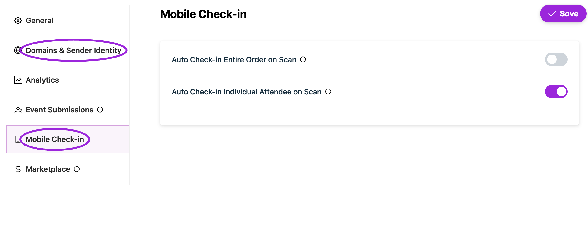
</Frame>

## Website setup

Follow [Website setup](/plugins/website-setup) to add Ticket Spot to your website or ecommerce store. Shopify, Wix, Ecwid, and WordPress have their own setup guides; other websites can use an embed.

| Functions         | Description                              | Reference |
|-------------------|------------------------------------------|-----------|
| **Connect Shopify**   | Connect Shopify store to sell tickets    | [Connect Shopify guide](../plugins/connect-shopify)  |
| **Shopify Ticket Selector** | Add time slots, seating, and shared capacity to event products | [Setup](../plugins/shopify-ticket-selector) · [FAQ](../plugins/shopify-ticketing-faq) |
| **Connect Ecwid** | Connect your store and publish event tickets | [Ecwid setup](/plugins/connect-ecwid) |
| **WordPress** | Install the plugin and add your event widget | [WordPress setup](/plugins/connect-wordpress) |
| **Squarespace** | Install the event widget with embed code | [Squarespace setup](/plugins/connect-squarespace) |
| **Any website** | Add a calendar or tickets with generated embed code | [Website embed guide](/plugins/embed-on-your-website) |
| **Connect Wix**       | Integrate Ticket Spot into Wix website   | [Connect Wix guide](../plugins/connect-wix)  |
| **Connect Lovable**       | Integrate Lovable with Ticket Spot  | [Connect Lovable guide](../plugins/connect-lovable)  |

<Frame caption="Website and ecommerce connections are under Integrations → Platform Integrations. The example shows the Demo Shopify connection alongside Wix and Ecwid.">
  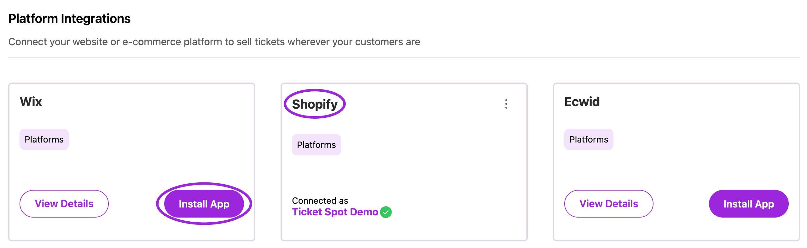
</Frame>

## Team

Invite teammates, assign roles, and collaborate with controlled access and permissions.

| Functions                     | Description                             | Reference |
|-------------------------------|-----------------------------------------|-----------|
| **Invite Your Team & Assign Roles** | Add team members and assign roles     | [Invite Your Team & Assign Roles guide](../team/invite-team-roles)  |
| **Manage Invitations**            | View, remove, or resend invitations     | [Manage Invitations guide](../team/manage-invitations)  |

<Frame caption="Choose Invite Team → Invite Team Member, enter an email address, and select Admin, Ticket Checker, Support Manager, or Event Manager.">
  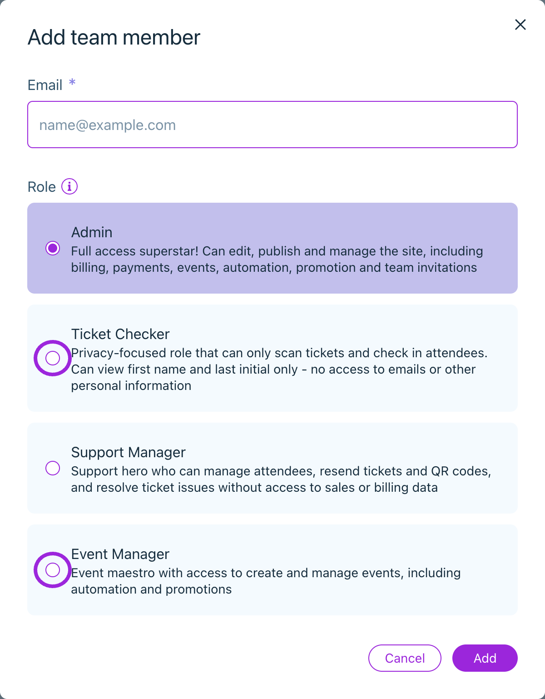
</Frame>

## Account

Manage your profile, payouts, and notifications from Account. On Events, click the Current plan card to view usage, or choose Manage plan to open Billing.

| Functions        | Description                             | Reference |
|------------------|-----------------------------------------|-----------|
| **Account Settings** | Update personal profile settings        | [Account Settings guide](../account/account-settings)  |
| **Get Paid**         | Configure payout settings               | [Get Paid guide](../account/get-paid)  |
| **Notifications**    | Manage email and app notifications      | [Notifications guide](../account/notifications)  |
| **Billing & Plans**  | Manage billing, invoices, and subscription plans | [Billing & Plans guide](../account/billing-and-plans)  |

<Frame caption="Open Account in the top-right corner for profile settings, payouts, and notifications. Use the Current plan card on Events for usage and billing.">
  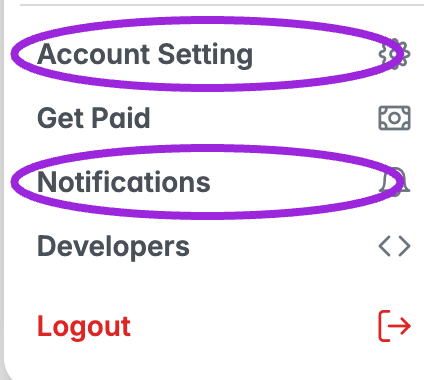
</Frame>

## Frequently asked questions

<AccordionGroup>
  <Accordion title="When do tickets count toward my monthly attendee allowance?">
    Tickets count in the calendar month they are issued, when the purchase or registration is processed. Event dates and check-in dates do not change that month. If you issue 600 tickets in October for November and December events, all 600 count toward October. On a 500-attendee Professional allowance, you need capacity for the extra 100, assuming no other October usage.

    See [monthly allowance rules and ticket packs](/account/billing-and-plans#when-tickets-count-toward-your-monthly-allowance).
  </Accordion>
  <Accordion title="Where can I see how many included attendees I have used and how many remain?">
    Select your site and open **Events**. Click the **Current plan** card's heading or usage message to open **Usage & Add-Ons**, then read **ATTENDEES → Used this cycle**, **Remaining**, and **Available Now**. Owners and admins can see this card, including when it only says **Usage is within plan limits**. **Manage plan** opens Billing to change your plan or add credits.

    <Frame caption="Click the Current plan heading or usage message to see the detailed balance. Demo account shown.">
      
    </Frame>

    Follow the [monthly usage walkthrough](/account/billing-and-plans#check-your-current-monthly-usage).
  </Accordion>
  <Accordion title="Can I use Ticket Spot in another language?">
    Turn on **Automatic translation** in **Design → Widget → Quick Settings** for supported built-in widget and checkout labels. For translated emails and tickets, enable **Multilingual communications** separately in **Design → Attendee Communication**. Your own event descriptions and custom messages need their own translations.

    See the [Language and locale FAQ](/getting-started/language-and-locale-faq) for preview languages, custom wording, translated emails, and regional settings.
  </Accordion>
</AccordionGroup>

For broader questions about pricing, integrations, and event features, visit the [general Ticket Spot FAQ](https://ticketspotapp.com/faq). The [Language and locale FAQ](/getting-started/language-and-locale-faq) focuses on translation and regional settings.
