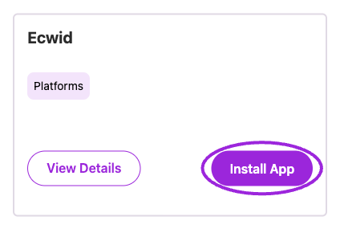
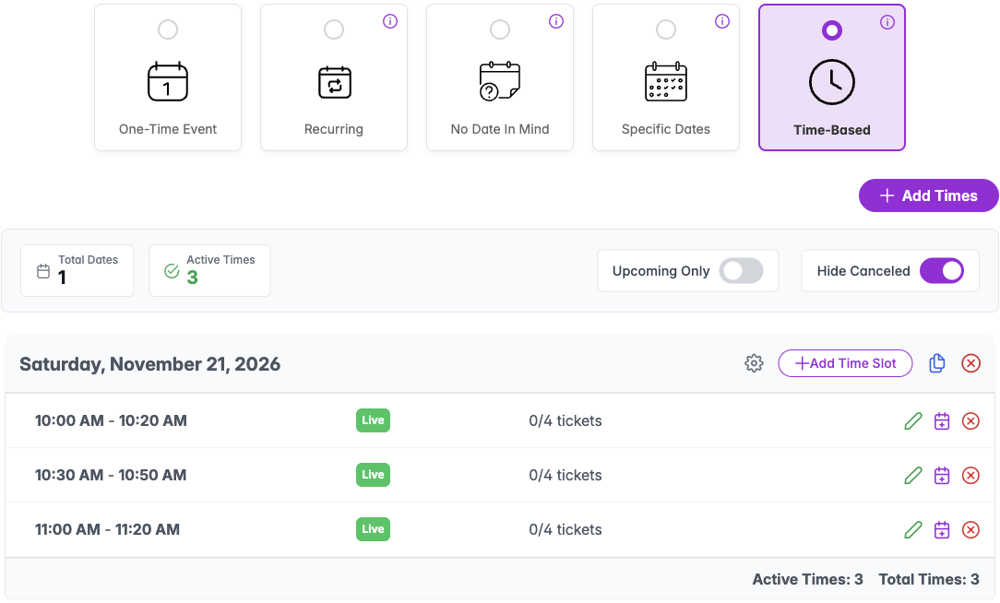
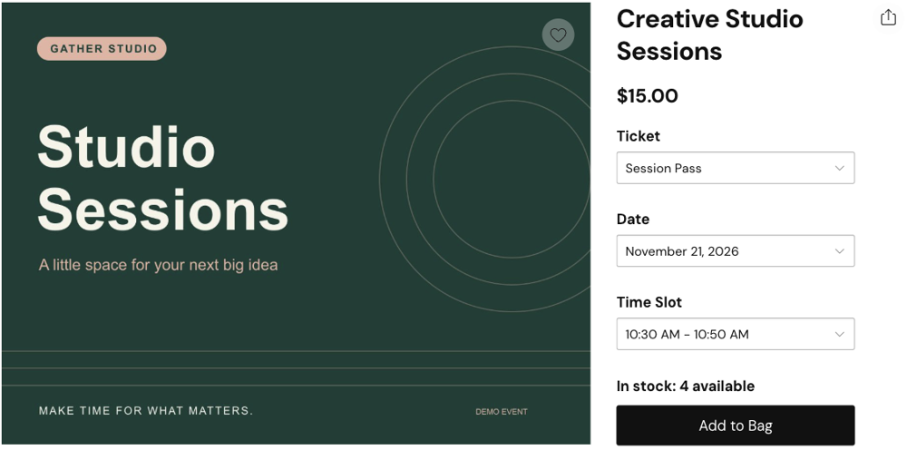
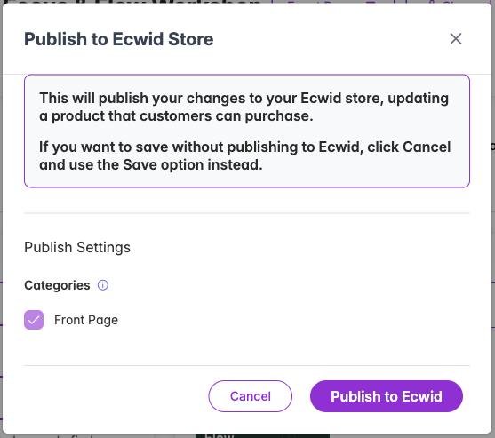

Create your event and tickets in Ticket Spot, then publish the event as a product in your Ecwid store. Customers order through Ecwid checkout, and Ticket Spot creates the linked attendee records.

## Choose your checkout

- **Sell event products through Ecwid checkout.** Publish events in your Ecwid catalog so customers use your store's payment methods. Follow the product setup below.
- **Sell through a Ticket Spot widget.** Add the widget to an Ecwid page or another website so customers use Ticket Spot checkout and your connected payment provider. Start with [Embed on your website](/plugins/embed-on-your-website) and [Get Paid](/account/get-paid).

The [Ecwid App Market listing](https://www.ecwid.com/apps/featured/ticket-spot) describes both routes. Choose the route before configuring payments; publishing an Ecwid product does not configure a Ticket Spot widget checkout.

## Before you start

- Sign in to the Ecwid store where you want to install Ticket Spot, with permission to install apps and manage products.
- Have an event name, date, location, ticket prices, and capacity ready. Check [Ticket Spot plan requirements](/account/billing-and-plans) for the features you need.
- Confirm that product variations are available for your Ecwid store. Ticket Spot uses them for ticket and date choices; Ecwid's [variation guide](https://support.ecwid.com/hc/en-us/articles/207100299-Product-variations) lists Business and Unlimited availability. Check your store's entitlement before changing plans.
- Set up the payment methods for your store in Ecwid before testing paid ticket purchases. Ecwid processes product orders through its store checkout.

The remaining steps cover Ecwid product sales.

## Install and connect

1. Open the [Ticket Spot listing in the Ecwid App Market](https://www.ecwid.com/apps/featured/ticket-spot). You can also open Ticket Spot **Integrations → Platform Integrations** and choose **Install App** on **Ecwid**.
2. Complete installation for the intended store and follow the sign-in instructions. If Ticket Spot asks you to sign in to finish linking the installation, complete that step.
3. In Ticket Spot, use the site selector to confirm you are working in the workspace for that Ecwid store.

<Frame caption="Use the Ecwid installation card to connect the store where you will sell tickets.">
  
</Frame>

## Create your first event

Start in the workspace connected to your Ecwid store. Choose **Create Event**, pick a template, and enter your event name.

### One-time event

1. Choose **One day** and set the start and end date and time.
2. Choose paid tickets or free RSVP. Add the ticket name, price, and available quantity, then choose **Create my event**.
3. Open the event to finish its description, image, venue, and timezone. Check the date under **Dates & Times** and ticket details under **Tickets**.
4. Save your changes, then [publish the event to Ecwid](#publish-to-your-ecwid-store).

### Time-based event

Use this format when guests choose a session, such as a 20-minute studio visit.

1. Create the event and its ticket first. Before taking bookings, open **Dates & Times → Time-Based**.
2. Choose **Add Times**. Enter the event day and each session's start and end time, then choose **Create**. You can add several days with the same sessions.
3. Check the saved list: each session should have the correct time, **Live** status, and capacity. Check the event's timezone in **Event Details**.
4. [Publish to Ecwid](#publish-to-your-ecwid-store), then open the storefront. The customer should be able to choose **Ticket**, **Date**, and **Time Slot**.
5. Test a later slot as well as the first one. Confirm the attendee is assigned to the chosen session and that only that session's available capacity decreases.

<Note>
Choose the date format before accepting bookings. Once an event has attendees, you cannot switch its date format.
</Note>

<Frame caption="One day with three sessions, each with four available places.">
  
</Frame>

For other formats, see the [event-type guides](/event-types/overview).

### Ticket and date choices

Your ticket types and dates become product options and variations in Ecwid. For example, a workshop with **Adult** and **Child** tickets on two dates has four ticket/date combinations. Each combination has its own price and available quantity.

| Event setup | Ecwid product choices |
| --- | --- |
| A single event with ticket types | **Ticket** |
| A recurring event with ticket types | **Ticket** and **Date** |
| A timed event with ticket types | **Ticket**, **Date**, and **Time Slot** |

<Frame caption="A timed event offers Ticket, Date, and Time Slot choices in the Ecwid storefront.">
  
</Frame>

Check every date and time you intend to sell in the storefront, confirm they match your event's timezone, and verify the available quantity for each combination. A Ticket Spot event setting does not necessarily have an equivalent in Ecwid checkout; test the product route before relying on a feature for your event.

<Note>
Exclusive time slots use Ticket Spot checkout and cannot be published to an external store catalog. Use the [exclusive booking guide](/bookings/exclusive-time-slots) for that workflow.
</Note>

### Registration questions and buyer details

The Ecwid product publisher maps text input, radio buttons, dropdowns, checkboxes, and date-picker questions to Ecwid product fields. Check required fields and answer choices on the published product. Other question types and advanced question rules are not covered by this mapping; verify a suitable checkout route before using them.

An Ecwid order supplies the buyer's name and email to Ticket Spot. Product answers apply to the order line: if someone buys two of the same ticket in one line, both attendee records receive that buyer's details and those answers. This does not collect a separate name or questionnaire for each guest. Plan how you will collect individual guest information if your event needs it.

## Publish to your Ecwid store

1. Open the event in Ticket Spot and choose **Publish**. If separate destination buttons appear, choose **Publish to Ecwid**.
2. In **Publish to Ecwid Store**, review the **Categories** choices for your store.
3. Choose **Publish to Ecwid** to create or update the store product. **Save** keeps your event changes without publishing them to Ecwid.
4. Open **Ecwid · Product linked**, then choose **Open in Ecwid** to inspect the linked product.
5. Check its store visibility, category placement, dates, ticket options, prices, and available quantities. Open the public storefront to confirm a visitor can find it.

<Frame caption="Review the categories, then publish the event to Ecwid.">
  
</Frame>

Make later event and ticket changes in Ticket Spot and publish to Ecwid again when you want to update the linked product.

### Where to edit a published product

Keep event titles, descriptions, images, questions, dates, ticket prices, and capacity in Ticket Spot. Republishing updates the linked product and its variations, and can replace direct Ecwid edits to those fields. Variations that no longer belong to the event can be removed during an update.

Use Ecwid for store checkout, payment methods, and storefront settings. Preserve the linked product and its ticket variations: a manually duplicated product or recreated variation does not automatically acquire its connection to Ticket Spot. After republishing, check category placement, ticket choices, prices, and quantities again.

## Set up ticket delivery

In the event's **Email Communication**, open **Ticket Confirmation → Manage**, review **Enabled**, and configure the message and ticket actions. See [confirmation email setup](/event-management/email-communication#ticket-confirmation) for the controls and [Attendee Communication design](/branding-and-design/attendee-communication-design) for shared styling.

An Ecwid order receipt and a Ticket Spot ticket confirmation are separate messages. During your purchase test, check the Ticket Spot email, its ticket links or PDF, and the event/date printed on the ticket. A design preview or sample email alone does not verify delivery for an Ecwid purchase.

## Test the purchase and attendee record

Open the published product as a visitor and check both desktop and mobile. Select the intended event date and ticket option, enter the required information, and complete an order through Ecwid checkout.

Verify the result in both places:

- **Ecwid:** confirm the product, selected options, quantity, order total, and payment status. Check that a ticket-only purchase does not unexpectedly request shipping.
- **Ticket Spot:** open the event's attendee dashboard and find the order and attendees. Check the attendee count, buyer details, answers, date, and ticket type against the purchase.
- **Ticket delivery:** check the buyer's inbox and the attendee's [email delivery history](/attendee-management/email-and-sms-delivery). Open the delivered ticket and confirm its event details and QR code.

Include a purchase with **quantity two**: the order should create exactly two attendees. For a recurring or timed event, also purchase a later date or time slot and check the selected occurrence, ticket details, and remaining capacity. Check what happens when a ticket sells out and after you edit and republish the event. Complete the [launch checklist](/getting-started/launch-checklist) before promoting it.

## Payments, refunds, and order changes

<Warning>
Ticket Spot creates attendees when an Ecwid order is placed, including when payment is still pending. An **Attending** record is not proof of payment. Check the payment status in Ecwid before treating a paid booking as settled.
</Warning>

Later Ecwid payment, fulfillment, refund, cancellation, or order-deletion changes do not automatically update those Ticket Spot attendee records. Ecwid fulfillment status also does not indicate whether a guest has checked in at your event.

| Change you need to make | What to do |
| --- | --- |
| Verify or collect payment | Review the order in Ecwid and the payment provider used for that order. |
| Return money | Follow [Ecwid's refund instructions](https://support.ecwid.com/hc/en-us/articles/115005863005-Marking-orders-as-refunded) for your provider. Marking an order refunded is not always the action that returns the funds. |
| Cancel an Ecwid order | Follow [Ecwid's cancellation instructions](https://support.ecwid.com/hc/en-us/articles/115005862165-Canceling-orders), then review the linked attendees in Ticket Spot separately. |
| Remove a guest from the attending list | Review the attendee in Ticket Spot and use [Change Status](/attendee-management/managing-attendees#change-an-attendees-status) as appropriate. Changing attendance does not issue an Ecwid refund. |
| Change tickets, dates, or quantities after purchase | Review both systems and contact support if you need help keeping the records aligned. Editing one record does not automatically update the other. |

After a cancellation or refund, review both the store's available stock and the event's attendee list before selling the released places again. Keep the Ecwid order number with your booking notes so your team can reconcile changes.

## Troubleshooting

| What you see | What to check |
| --- | --- |
| Ecwid publishing is missing | Confirm that the selected Ticket Spot workspace belongs to the connected Ecwid store. |
| Event changes are missing in the store | Use **Publish to Ecwid** after editing; **Save** alone does not publish the product update. |
| The product is hard to find | Check its visibility and category placement in Ecwid, then visit the published storefront. |
| An Ecwid order has no Ticket Spot attendee | Confirm the purchase used the product linked from the Ticket Spot event and the intended ticket option. Keep the Ecwid order number and event details when contacting support. |
| The organizer's Ecwid order email is missing | In Ecwid, check **Settings → Notifications**, the new-order notification, and its recipient address. This is separate from Ticket Spot ticket delivery. |
| The buyer's Ticket Spot ticket email is missing | First confirm the attendee exists. Then check **Email Communication → Ticket Confirmation** and the attendee's [email delivery history](/attendee-management/email-and-sms-delivery). Check the buyer address and spam folder. |
| Several attendees have the buyer's details | Ecwid supplies buyer details and product-line answers. See [Registration questions and buyer details](#registration-questions-and-buyer-details). |
| A refunded or cancelled order still shows Attending | Review the Ecwid payment/order state and Ticket Spot attendance separately; see [Payments, refunds, and order changes](#payments-refunds-and-order-changes). |

## Next steps

- [Manage attendees and orders](/attendee-management/managing-attendees).
- [Customize attendee communications](/branding-and-design/attendee-communication-design).
- [Prepare event check-in](/mobile-app/mobile-app-overview).
- [Explore more features](/guides/overview).
