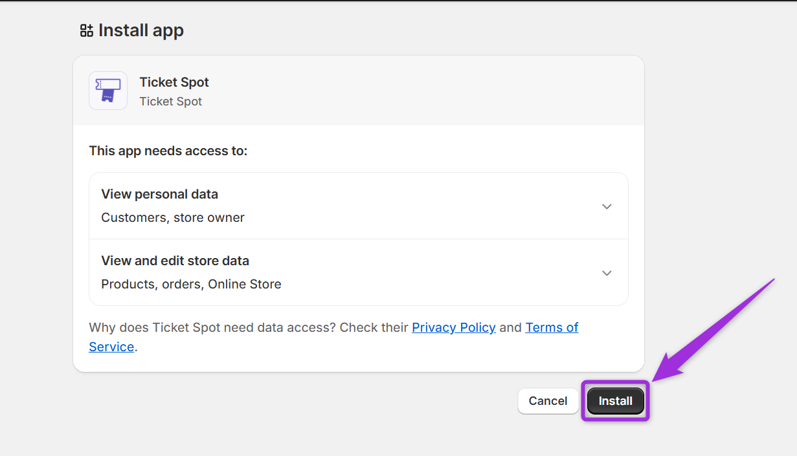
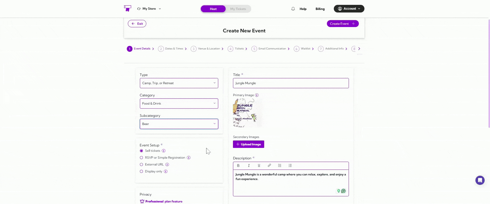
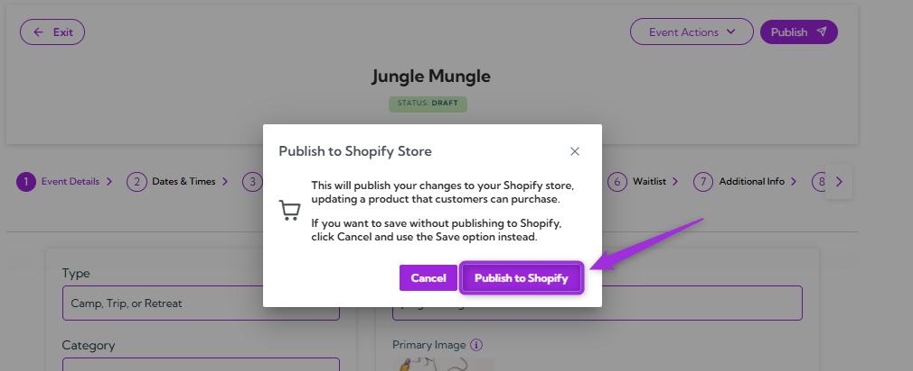
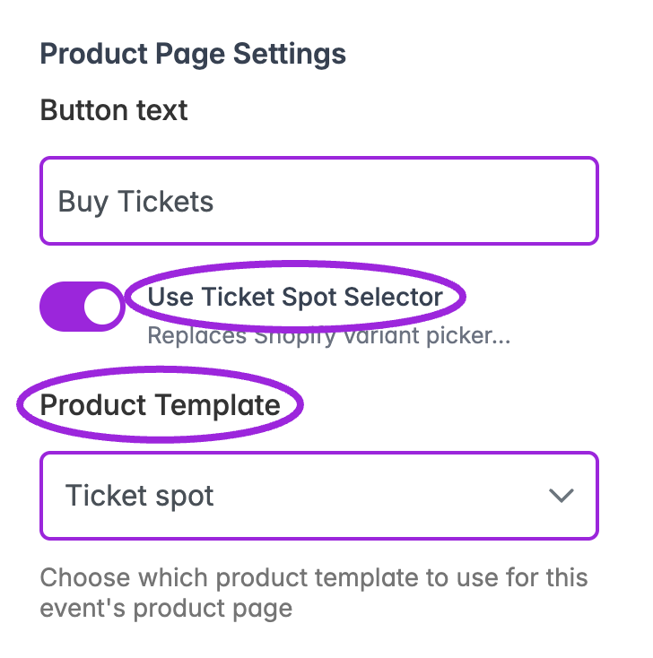
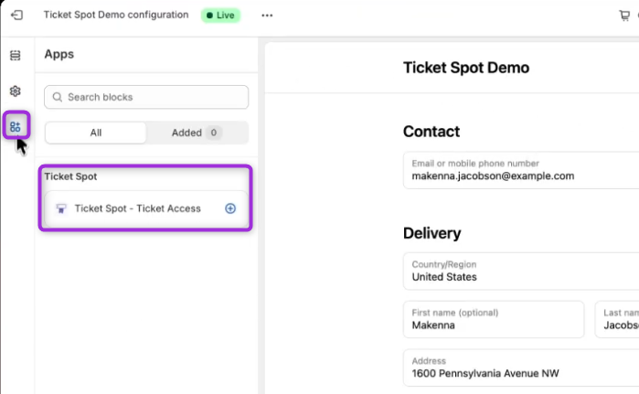
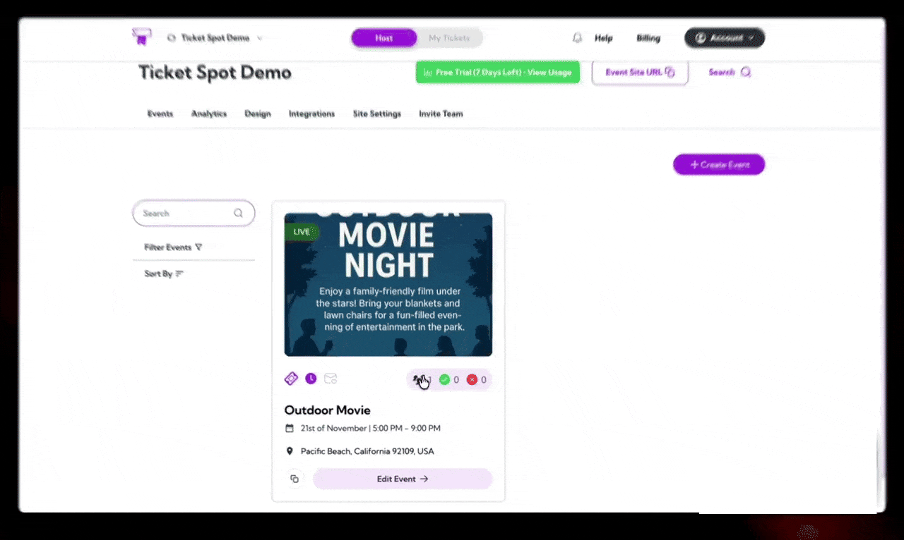
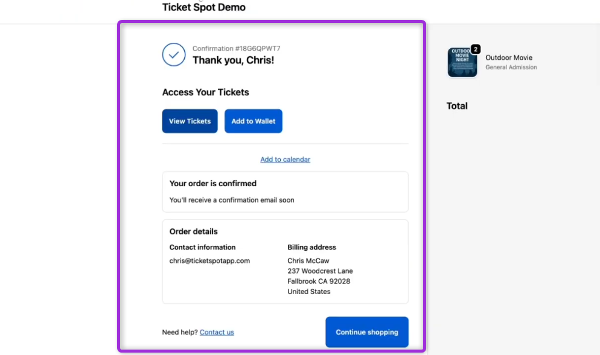
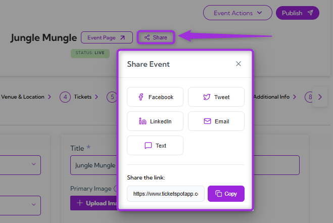
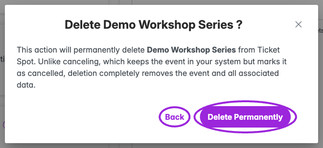

Follow this guide to sell your first event through **Shopify checkout**. You will connect your store, create an event product, configure the booking flow, and verify a purchase and delivered ticket before sharing the event.

Already selling tickets? Use the [Shopify guides](./shopify-overview) to find setup for dates, seating, add-ons, orders, and troubleshooting.

## Before you start

- Use a Shopify account with permission to install apps and edit the store's theme.
- Have your event's dates, venue, ticket prices, and capacity ready. [Choose your event type](/event-types/overview) if you need help deciding the setup.
- For paid tickets, configure payments in **Shopify**. Shopify product purchases use Shopify checkout; the separate **Get Paid** provider connections in Ticket Spot serve other checkout routes. See [payment workflows](/account/get-paid#choose-the-correct-payment-workflow).
- If your event needs the **Ticket Selector**, use a Shopify theme with app-block support. For a store that also sells merchandise, use a separate event product template so its booking controls apply to your event products.

## Connect your store

In Ticket Spot, open the site-name menu at the top left and select **+ Create Workspace**. Expand **Connect an existing store instead**, then choose **Connect Shopify**. Older screens may show **+ Add New Site** and **Create or Connect Your Site** for this entry point.

<Frame caption="Open Connect an existing store instead and choose Connect Shopify.">
  
</Frame>

## Install the Ticket Spot App

1. On the Ticket Spot listing in the Shopify App Store, choose **Install**.
2. Sign in to the intended Shopify store, review the requested access, and choose **Install** to authorize Ticket Spot.
3. After returning to Ticket Spot, confirm that the selected site is the store you want to use.

If the app is already installed and your store is selected in Ticket Spot, continue with your event.

## Create Your Event

Select **Create Event** and follow the [event creation guide](/event-management/create-event-overview). Set the title, description, date and timezone, venue, ticket prices, and capacity. Add any required attendee questions and review your confirmation email.

Use **Continue later** in guided setup if you need to finish the event as a draft. **Create my event** can publish when its requirements are met. Review the saved event's status before continuing.

## Publish Your Event to Shopify

1. Open the event and choose **Publish**.
2. Choose **Publish to Shopify** to create or update the product customers will purchase.
3. Check the event's **Shopify · Product linked** panel. If it reports **Out of sync**, resolve the mapping warning before selling.

The linked product is needed for the template assignment below. Complete the storefront setup and purchase checks before promoting its link.

## Set up ticket selection

Use the **Ticket Selector** when customers need to choose a date, time, or seat; when ticket types share an event capacity; or when you collect individual guest details, event questions, or waivers. It also provides Ticket Spot waitlists, access codes, event add-ons, and campaign tracking on Shopify.

These features need the selector's booking flow. Shopify's ordinary variant picker does not provide the Ticket Spot date calendar, seating map, or access-code form. Review [when to use the selector](./shopify-ticket-selector#when-to-use-the-ticket-selector) for your event.

1. In **Shopify Admin → Online Store → Edit theme**, choose or create a product template for event tickets. Some stores show **Themes → Customize** instead.
2. In the template's product section, choose **Add block → Apps → Ticket Selector**. Set **Display Mode** to **Embed inline** or **Modal**.
3. Hide competing variant, quantity, buy-button, and accelerated checkout controls on this event template so customers complete the required booking steps. Save the template in Shopify.
4. Return to the Ticket Spot event and open **Shopify · Product linked**.
5. Enable **Use Ticket Spot Selector**, choose the **Product Template** containing the block, and click **Save Settings**.
6. Open the actual Shopify product and confirm that its assigned template displays the selector.

<Frame caption="Choose the template containing the Ticket Selector app block, then save the linked-product settings.">
  
</Frame>

Adding the block and assigning the template are separate steps. Ticket Spot lists templates from the **published Shopify theme**. A template selected only in the editor's preview has not been assigned to the product. Follow the [complete selector installation guide](./shopify-ticket-selector#install-the-product-block) for screenshots of each step.

If you need individual guest names, questions, or waivers, leave **Skip Attendee Details Form** off. For separate details per ticket, also enable **Collect attendee details for each ticket** in **Design → Widget → All Settings → Checkout**. See [attendee-information settings](./shopify-ticket-selector#product-settings-and-attendee-details).

## Enable the Ticket Block on the Thank You Page

This optional step lets buyers open their tickets directly after payment. It uses the separate **Ticket Spot – Ticket Access** block; installing the product-page selector does not add it.

1. In Shopify, open **Settings → Checkout → Customize** to open the checkout editor.
2. Select the **Thank You** page and add **Ticket Spot – Ticket Access** from **Apps**.
3. Click **Save**.

## Check Out the Event

Open the linked product on your actual Shopify storefront, using **Open in Shopify** from the linked-product panel. Check the public page on desktop and mobile; the theme editor's preview alone does not verify the customer flow.

1. Select the date or time, ticket type, quantity, and seat that apply to your event.
2. Enter the required attendee details and any question or waiver responses.
3. Continue through Shopify's cart or direct checkout and check the selected tickets, price, and total.
4. Complete a purchase using an email address you can check. Confirm that the Shopify order completed; reaching checkout alone does not issue tickets.

Continue through the checks below before sharing the event.

### Verify your booking rules

Test the rules your event uses: the correct date/time, ticket minimum and maximum quantities, available and sold-out seats, accepted and rejected access codes, and any [Required Ticket](/event-management/ticket-setup#required-ticket) dependency. For recurring events, check another occurrence and an unavailable session. Use the [complete purchase checklist](./shopify-ticket-selector#verify-the-complete-purchase) for waitlists and other selector features.

## View Attendees in Your Dashboard

After the purchase completes, Shopify sends the order and attendee details to Ticket Spot. Open your event's attendee dashboard and find the test order.

Check that the ticket quantity, selected occurrence, seats, and required answers match the purchase. Open **View Order** to review the linked order; **View Shopify Order** opens its Shopify record when available. See [attendee orders](/attendee-management/managing-orders).

## Check ticket delivery

Check the buyer's inbox for the confirmation and open the delivered ticket link. Verify the event details and QR code. A completed order, an attendee record, and a delivered ticket are separate checks.

If the message is missing, use [email and SMS delivery troubleshooting](/attendee-management/email-and-sms-delivery). If the order or attendee is missing, start with [Shopify purchase troubleshooting](./shopify-ticket-selector#troubleshooting).

### Access Tickets on the Thank You Page

If you added **Ticket Spot – Ticket Access**, check the completed order's Thank You page. Open **View Tickets** and verify the ticket; check **Add to Wallet** if you offer that option.

Ticket access on this page is checked separately from email delivery.

## Share your event

Once the purchase, attendee record, and ticket delivery are correct, use **Share** to copy and promote your event link. Open the copied link to confirm it leads to the intended purchase page.

For a campaign, create a [tracking link to your Shopify product](./shopify-ticket-selector#tracking-links-to-shopify-products) and share the complete generated URL.

Prepare for the event with [mobile QR-code check-in](/mobile-app/mobile-check-in), or return to the [Shopify guides](./shopify-overview) to add more features.

## Keep products synchronized

Republish the event after changing its ticket offer, then check the linked product and [Ticket Selector](./shopify-ticket-selector). When a corresponding setting is omitted from an update, Ticket Spot preserves the product's existing type, theme template, vendor, variant tax settings, collections, and publication channels. Explicit changes to those settings still apply.

Import an existing Shopify product through the connected-store import flow. Ticket Spot checks for an existing link to prevent duplicate event creation; inspect the linked event when an import is rejected rather than creating a second copy to bypass it.

Deleting a linked event archives its Shopify product. Review the [Delete Event confirmation](/event-management/manage-events#delete-event) before proceeding; this is separate from canceling one event date or refunding an order.

<Frame caption="Deleting a linked Shopify event also archives its product. This is the Ticket Spot confirmation, not Shopify admin.">
  
</Frame>

These protections apply when you perform a new import, update, or deletion. They do not automatically repair an old duplicate link or restore settings that were overwritten earlier.

## Existing product configuration controls

Open **Shopify · Product linked → Product Page Settings** in the event editor. Older screens may call this **Shopify Setup**.

- **Button text** sets the selector's launch-button label.
- **Use Ticket Spot Selector** enables the Ticket Spot selection experience.
- **Product Template** assigns the template containing the selector block.
- **Enable Direct Checkout** skips Shopify's cart page and continues to checkout.
- **Skip Attendee Details Form** uses the Shopify purchaser's contact information. Leave it off when collecting guest names, event questions, or waivers.
- **Show ticket status on button** displays availability such as sold out or ended.

Click **Save Settings** to apply these options. See the [full linked-product settings reference](./shopify-ticket-selector#product-settings-and-attendee-details), including unlinking the product. Collection and Shopify inventory location are separate publishing settings; the inventory location does not change the event venue.

## Complete selector and block reference

See [Shopify Ticket Selector setup and options](./shopify-ticket-selector) for block settings, inline/modal behavior, product controls, and the difference between **Event Widget**, **Additional Questions**, and **Ticket Access**. Find answers about dates, inventory, and templates in the [Shopify ticketing FAQ](./shopify-ticketing-faq).

For waitlists, invitation-only sales, and private invoices, use the [waitlist guide](/event-management/waitlist). The [Shopify waitlist FAQ](./shopify-ticketing-faq#when-does-my-shopify-waitlist-start) explains when public sales switch to invitation-based purchasing.

## Offer extras with event tickets

Use [event add-ons on Shopify](./shopify-event-add-ons) for workshops, meals, and extra experiences. Create separate hidden events, publish each one as an Unlisted Shopify product, and attach them to the main event. Customers select extras after choosing their main ticket in the Ticket Selector.

<Accordion title="Watch the Shopify setup walkthrough">
  <iframe
    width="100%"
    height="400"
    src="https://www.youtube.com/embed/xIv6NPcxX4s"
    title="Connect Ticket Spot and sell event tickets on Shopify"
    frameBorder="0"
    allow="accelerometer; autoplay; clipboard-write; encrypted-media; gyroscope; picture-in-picture"
    allowFullScreen
  />
  For current product-template and app-block steps, follow the [Ticket Selector guide](./shopify-ticket-selector#install-the-product-block) and its [setup video](https://www.youtube.com/watch?v=grq-oS9AFgI&t=5s).
</Accordion>
