Add Ticket Spot to Wix, publish your first event, and check that a visitor can register and receive their ticket. Manage event details and attendees in Ticket Spot; use the Wix editor to place the event widget on your website.

## Before you start

- Sign in to the Wix account that can install apps and publish the intended website.
- Have your event name, date, location, ticket price, and capacity ready. The [first-event guide](/getting-started/first-event) walks through these choices.
- For paid tickets using Ticket Spot checkout, connect a provider in **Account → Get Paid** and finish its setup before taking orders. Follow [payment setup](/account/get-paid). Free registration does not need a payment connection.

Already installed the app? Start at [Open Event Management in Wix](#open-event-management-in-wix), then [publish your event](#publish-your-event) and [test the website](#check-out-the-event).

<iframe
  width="100%"
  height="400"
  src="https://www.youtube.com/embed/RbGp4tIfsy4"
  title="Install Ticket Spot on Wix and sell event tickets"
  frameBorder="0"
  allow="accelerometer; autoplay; clipboard-write; encrypted-media; gyroscope; picture-in-picture"
  allowFullScreen
/>

## Navigation

**Step 1**: Click the current site name at the top of Ticket Spot, then choose **+ Create Workspace**.

<Frame caption="Open the current site name to see Workspaces, then choose Create Workspace.">
  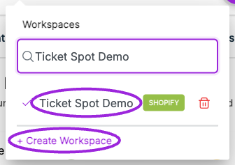
</Frame>

**Step 2**: Expand **Connect an existing store instead** and choose **Connect WiX** to open the Wix App Market listing.

<Frame caption="Choose the Wix connection in the workspace setup dialog.">
  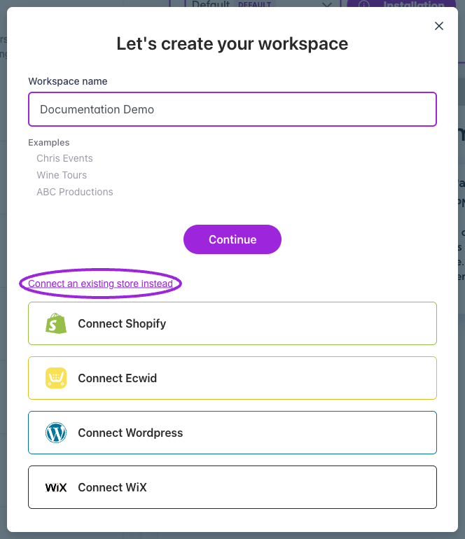
</Frame>

## Install the Ticket Spot App

You can install Ticket Spot on Wix using either method below:

### Option 1: Install Directly from Ticket Spot

Use the Wix connection described above, or open **Integrations → Platform Integrations** and choose **Install App** on Wix. In the Wix App Market, click **Add to Site**.

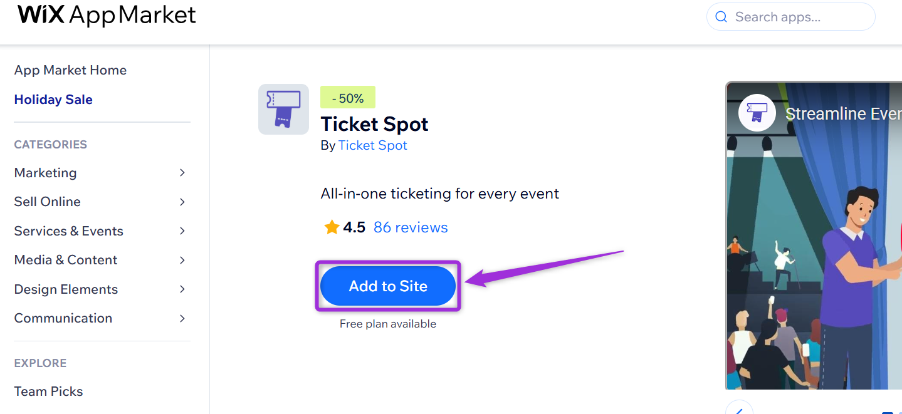

### Option 2: Install from the Wix App Market

From your Wix dashboard, open the **App Market**, search for **Ticket Spot** and click **Add to Site** to install the app.

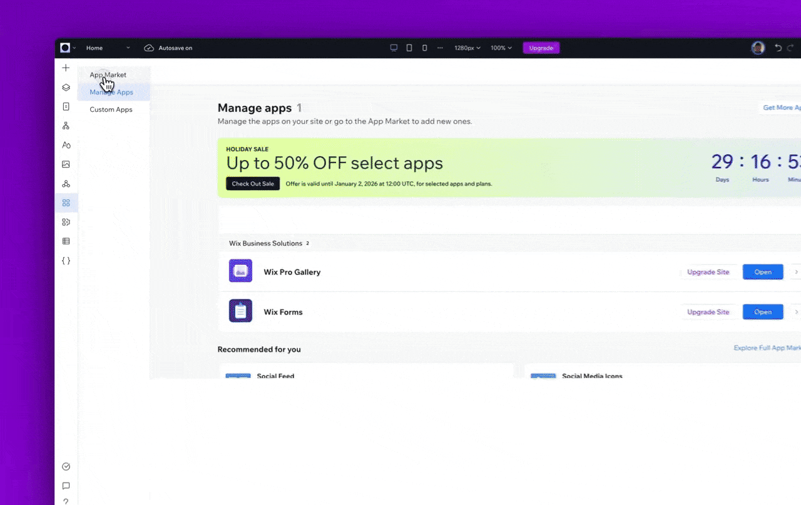

Review the permissions shown and click **Agree & Add** to complete the Ticket Spot installation on Wix.

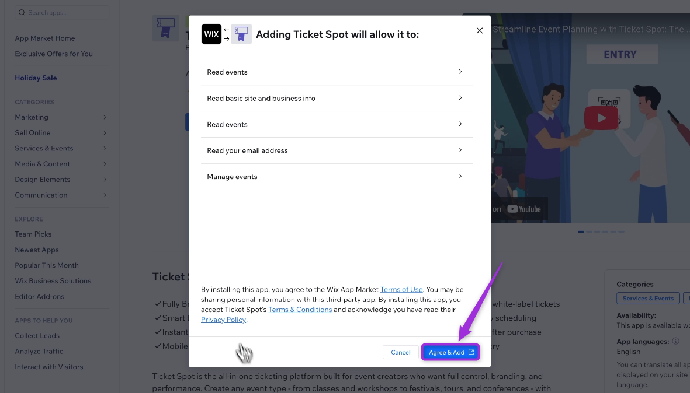

Both methods follow the same installation flow and connect your Wix site to Ticket Spot.

## Open Event Management in Wix

After installing Ticket Spot, Wix displays a few sample events by default. To access your event dashboard, go to **Settings** and then click on **Event Management**.

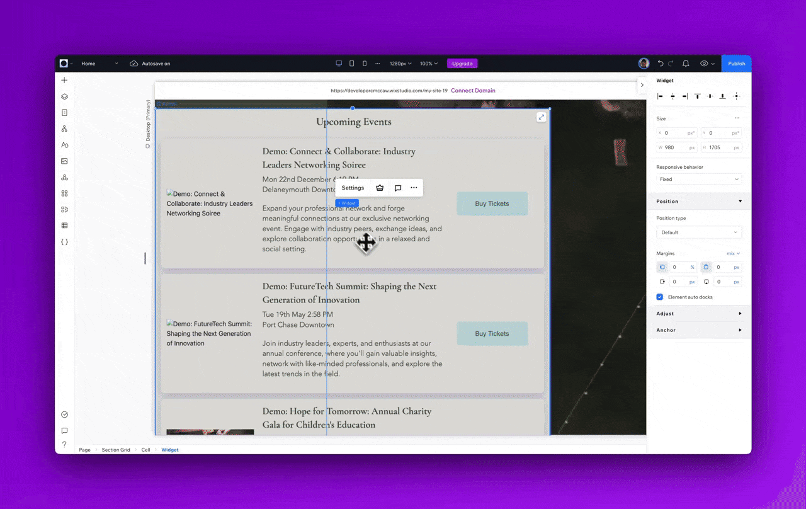

**Wix** will redirect you to the **Ticket Spot** web app, where you can create your own event.

### Create Your Event
To create your event, enter the basic details, such as the event name, date, time, and venue. These fields help set up your event in Ticket Spot and prepare it for publishing.

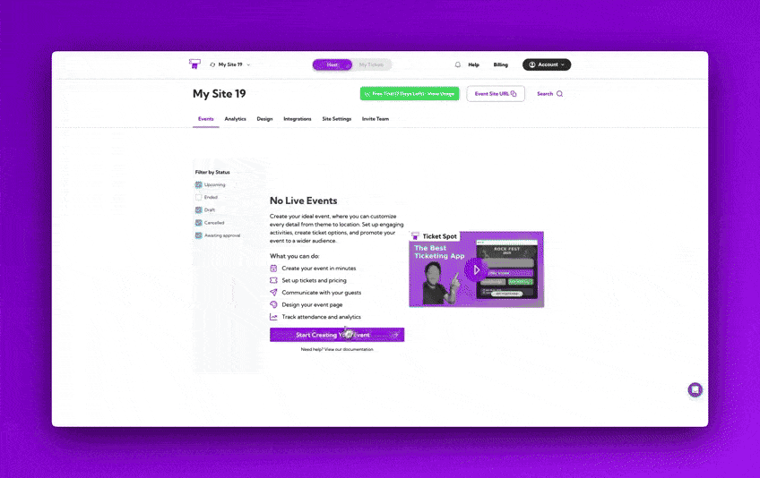

> For a full step-by-step walkthrough, please refer to our guide: **[How to Create an Event with Ticket Spot](../event-management/create-event-overview)**.

### Publish Your Event
Once your event details are configured—such as the title, date, tickets, and venue—you need to publish the event so it becomes active on your Wix site.

1. Click **Publish** in Ticket Spot to make the event live.
2. In the Wix editor, confirm the Ticket Spot widget is on the page where visitors will find your events. Check that its event filters include your new event.
3. Publish your Wix website after adding the app or changing the page layout. Publishing an event in Ticket Spot and publishing a website edit in Wix are separate steps.
4. Open the published Wix page as a visitor and confirm the event appears with the correct date, price, and available tickets.

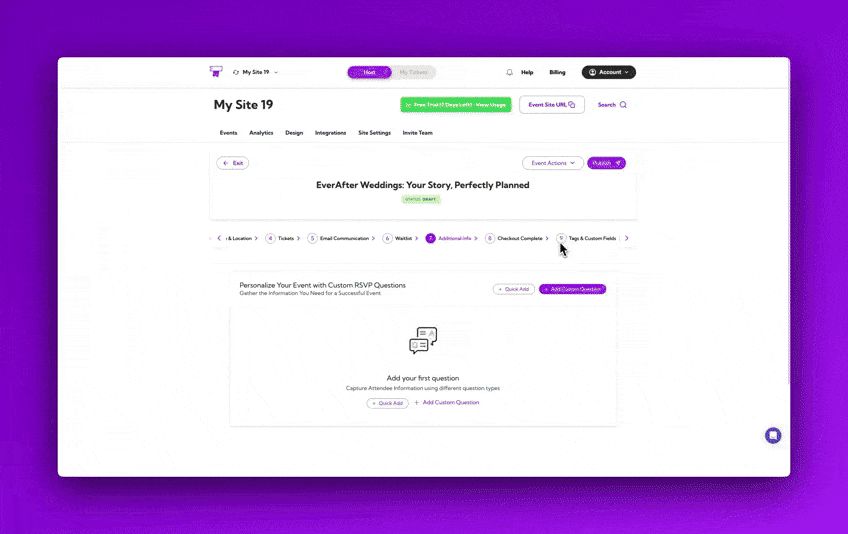

## Check Out the Event
Open your published Wix page in a private browser window. Check both desktop and mobile. For paid tickets, confirm your [payment provider is connected](/account/get-paid) before placing a test order.

1. Click **Buy Tickets** to open ticket selection.

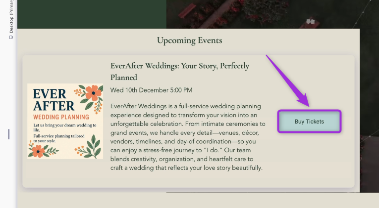

2. Select the ticket you want to purchase, enter the required attendee details, proceed with the payment, and complete your ticket order.

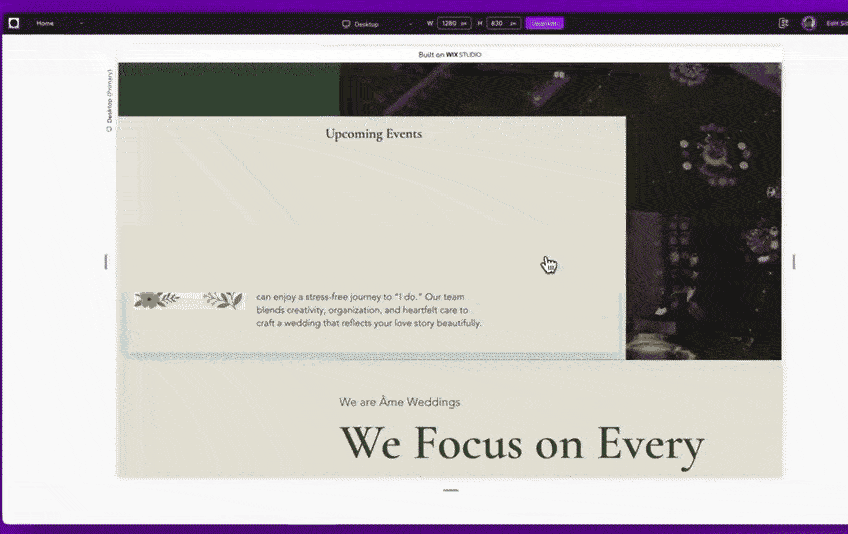

## View Your Tickets After Purchase

After completing your order, the confirmation page displays **View Tickets** and **View Receipt**. You can also click **Add to Calendar** to save the event to your personal calendar.

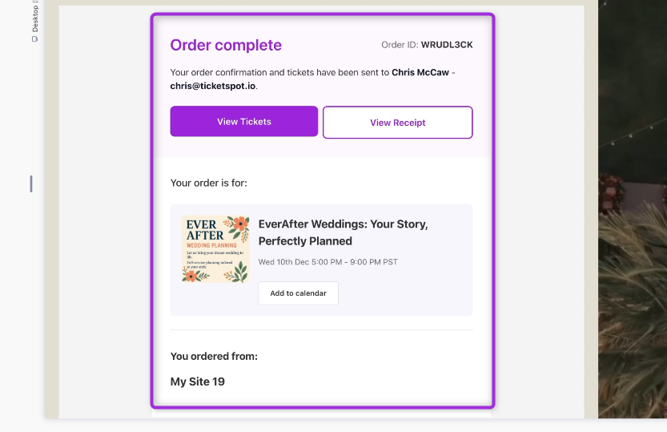

## View Attendees in Your Dashboard

After checkout, return to Ticket Spot and confirm that the test order and attendee appear for the correct event.

Click **Manage Attendees** to view your event's attendees.

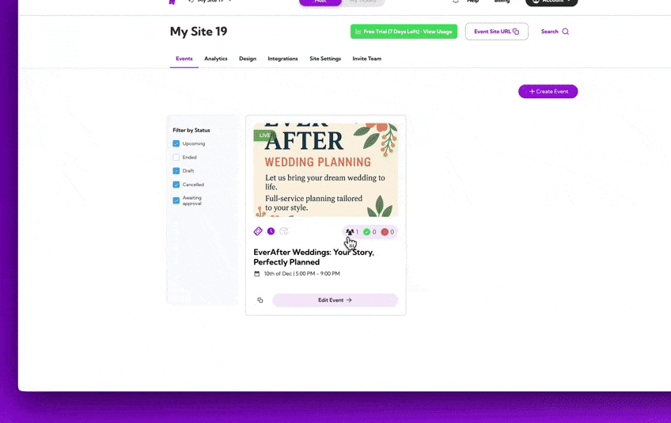

From this dashboard, you can review the full attendee list, update attendee statuses, filter records, export attendee data, resend ticket confirmations, and access detailed order information—all in one place.

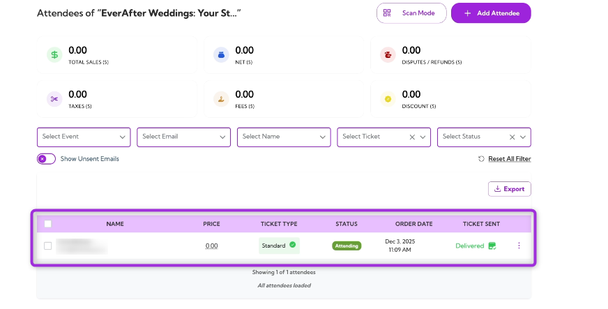

> Learn more: Explore the full **[Attendee Management](../attendee-management/viewing-attendee-details)** guide for detailed steps.

Check the confirmation email and its ticket link as well as the order shown on screen. Use the [launch checklist](/getting-started/launch-checklist) before sharing the page widely, or [troubleshoot a missing ticket](/attendee-management/email-and-sms-delivery).

## Customize Ticket & Email Design

Ticket Spot gives you full control over the look and feel of the tickets, receipts, and attendee emails your customers receive. In the **Design** section, you can update the ticket receipt layout, customize the ticket pass with its QR code, and change text, labels, and colors to match your brand.

You can also customize attendee-facing emails—show or hide specific components, adjust wording, and tune the overall appearance to create a consistent experience across your event communications.

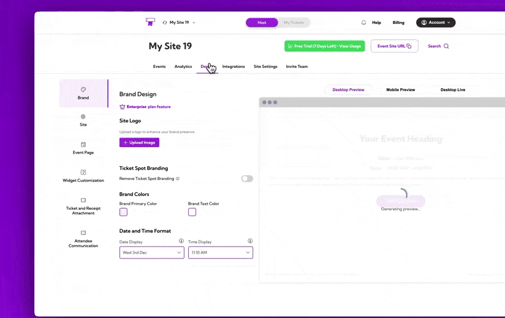

> **Learn more:**  
**[Ticket & Receipt Design](../branding-and-design/ticket-and-receipt-attachment-design)** →  
**[Attendee Communication Design](../branding-and-design/attendee-communication-design)** →

## Track Event Performance with Analytics

**Analytics** dashboard helps you understand how your event is performing. You can view ticket sales trends, monitor check-in activity, and identify any abandoned carts so you can follow up with potential attendees.

This gives you a clear picture of engagement throughout your event lifecycle and helps you take action where needed.

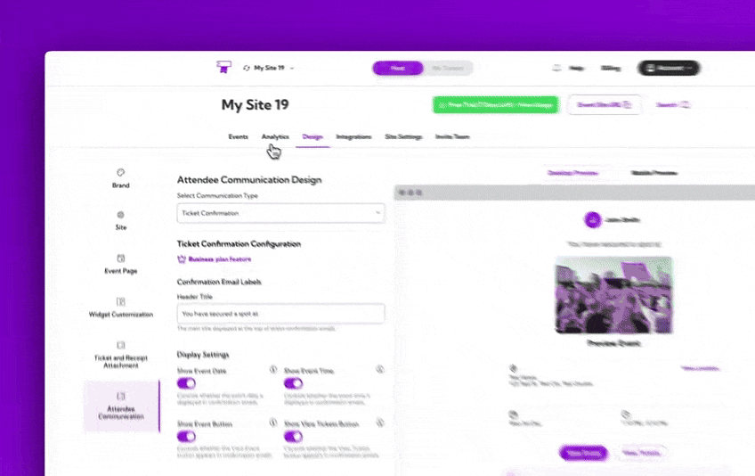

> Learn more: **[Analytics Overview](../analytics/analytics-overview)** →

## Next steps

- [Choose a guide for your event type](/event-types/overview), including classes, tours, and seated shows.
- [Prepare event check-in](/mobile-app/mobile-app-overview).
- [Explore more features](/guides/overview) when your first event is ready.
