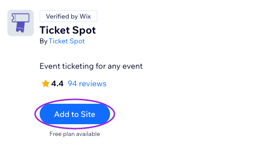
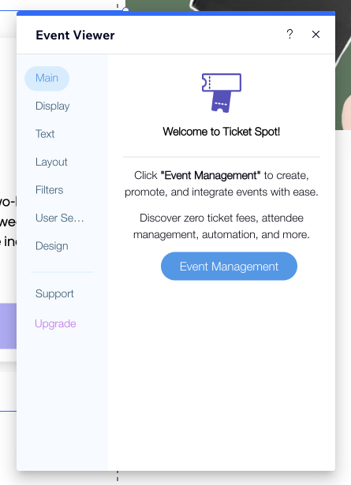
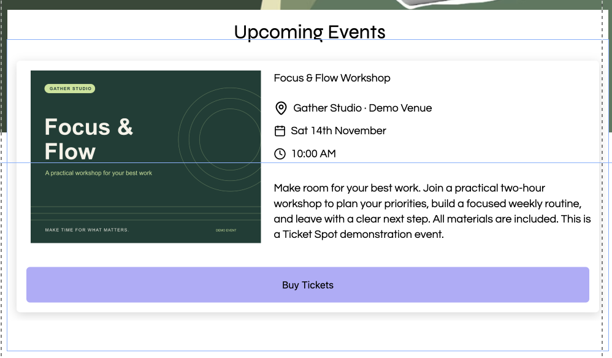

Add Ticket Spot to your Wix page, create an event, then publish your website. Already installed? Jump to [create your event](#create-your-event).

<Note>
For paid tickets, open **Account → Get Paid** in Ticket Spot and [connect a payment provider](/account/get-paid). Free registration does not need one.
</Note>

## 1. Install Ticket Spot

In Wix Editor, open **Add Apps** and search for **Ticket Spot**. In Wix Studio, use **App Market**. Choose **Add to Site** and confirm the installation.

You can also start from the [Wix App Market listing](https://www.wix.com/app-market/event-viewer).

<Frame caption="Choose Add to Site to install Ticket Spot on your Wix website.">
  
</Frame>

## 2. Create your first event

1. **Right-click the Ticket Spot widget** on your Wix page and choose **Settings**.
2. Choose **Main → Event Management**. Ticket Spot opens in a new tab.
3. Confirm the selected site is your Wix website, then choose **Create Event**.
4. Add your event name, date, venue, tickets, and capacity. Choose **Create my event**, then **Save** any further edits. Check that its status is **Live**.

<Frame caption="Open Event Management from the widget’s settings.">
  
</Frame>

For a walkthrough of the event form, see [Create your first event](/getting-started/first-event).

## 3. Show the event on your website

Return to Wix Editor and check that your event appears in the widget. In **Settings → Layout**, choose your desktop and mobile layouts. Then **Publish** your Wix website.

<Frame caption="Your live event appears in the Wix Editor widget.">
  
</Frame>

Saving a live event in Ticket Spot makes it available to the widget. Publishing in Wix makes your page and layout changes visible to visitors.

## 4. Test a booking

Open the published page as a visitor and complete a registration. Check that:

- The event, date, ticket, and price are correct on desktop and mobile.
- The confirmation and ticket link arrive at the attendee's email address.
- The booking appears in Ticket Spot under the event's **Open dashboard** button.

Use the [launch checklist](/getting-started/launch-checklist) before promoting your event.

## Optional settings

<Accordion title="Choose which events appear">
In the selected widget's **Settings**, use **Filters** to choose events. Leave **Enable Filters** off to show all matching events, or add rules using **AND** (every rule) or **OR** (any rule).

Under **Display**, check **Event Types and Status** and **Event Count Preferences**. These control live/past/sold-out visibility and how many events appear. See [filters](/branding-and-design/filters) and [display settings](/branding-and-design/display-settings).
</Accordion>

<Accordion title="Match your website's style">
Use **Layout**, **Design**, and **Text** in the widget's settings to adjust its presentation. Each widget can have different settings; select the one you want to change.

Ticket and email designs are managed separately in Ticket Spot: [ticket design](/branding-and-design/ticket-and-receipt-attachment-design) and [attendee emails](/branding-and-design/attendee-communication-design).
</Accordion>

<Accordion title="Start from the Ticket Spot dashboard">
Open the site-name menu, choose **+ Create Workspace**, expand **Connect an existing store instead**, and select **Connect WiX**. Continue installation in the Wix App Market.
</Accordion>

## Troubleshooting

<Accordion title="The widget is missing">
In Wix Editor, open **Add Apps → Manage Apps** and complete Ticket Spot's pending setup. To place the widget, use **Add Elements (+) → Apps → Ticket Spot**. See [Wix's pending-app instructions](https://support.wix.com/en/article/adding-a-pending-app-in-your-editor).
</Accordion>

<Accordion title="My event is missing or I only see sample events">
Open **Main → Event Management** from that widget. Check the selected site and that the event is **Live**. Then review **Filters**, **Display → Event Types and Status**, and event-count settings in Wix.
</Accordion>

<Accordion title="Event Management or ticket delivery isn't working">
If Event Management does not open, allow its new browser tab. If a booking succeeds but its email is missing, review [ticket delivery status](/attendee-management/email-and-sms-delivery).
</Accordion>

## Next steps

[Manage attendees](/attendee-management/managing-attendees), [prepare check-in](/mobile-app/mobile-app-overview), or [explore more features](/guides/overview).
