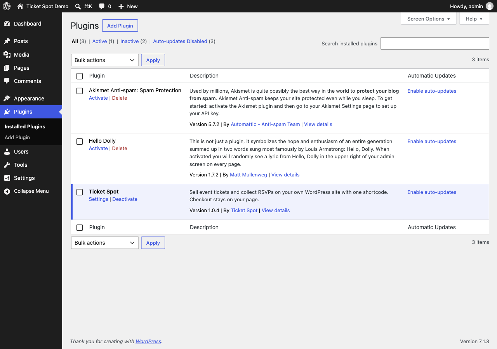
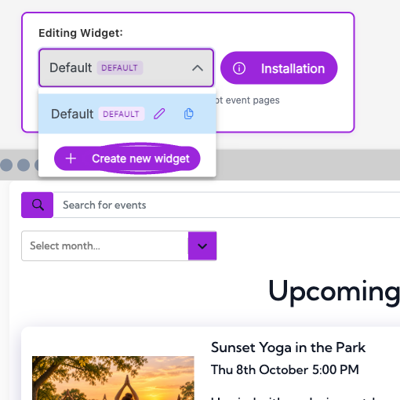

The Ticket Spot WordPress plugin displays your event widget inside a WordPress page or post. Create events, choose the widget's layout, and manage orders in the separate Ticket Spot dashboard. Then paste the widget's shortcode into WordPress.

## Before you start

You need a WordPress account with permission to install plugins and edit the page. Your WordPress hosting or plan must allow plugin installation. Sign in to your [Ticket Spot account](https://ticketspotapp.com/manage), or create one before continuing.

For paid tickets through Ticket Spot checkout, open **Account → Get Paid** and [connect your payment provider](/account/get-paid). Free registration does not require a provider. Review [Ticket Spot plan requirements](/account/billing-and-plans) for the features you plan to use.

## Install the plugin and widget

<Steps>
<Step title="Install and activate">
In WordPress, open **Plugins → Add Plugin** (**Add New** in older versions), search for **Ticket Spot**, and choose **Install Now**, then **Activate**. The official listing is [Ticket Spot – Event Tickets, RSVPs & Calendar](https://wordpress.org/plugins/ticket-spot/), by ticketspot.

You can also download the ZIP from that listing and use **Upload Plugin** on the same screen, then activate it.

<Frame caption="After activation, Ticket Spot appears in Installed Plugins with Settings and Deactivate links. Shown in a local WordPress demo with the released plugin.">
  
</Frame>
</Step>
<Step title="Open Ticket Spot and choose your workspace">
<span id="connect-your-site" />

The plugin's **Settings → Ticket Spot** page provides setup instructions and a link to Ticket Spot. Open the [Ticket Spot dashboard](https://ticketspotapp.com/manage) in a separate tab and sign in there. You do not enter your Ticket Spot credentials or select a workspace inside WordPress.

In Ticket Spot, open the site-name menu and choose the workspace whose events you want to display. If you need a new one, choose **+ Create Workspace**, enter a name, and select **Continue**. See [create and switch workspaces](/site-settings/add-and-switch-sites).

Create and publish your event in that workspace using the [first-event guide](/getting-started/first-event), or open an event you already have.
</Step>
<Step title="Choose or create your event widget">
Open **Design → Widget**. In **Editing Widget**, select the widget you want on this page. To create a separate calendar or event list, open the dropdown, choose **Create new widget**, enter its name, and select **Create**. Leave **Set as Default** off when you want a separate embed configuration.

<Frame caption="Choose an existing widget or create one for this WordPress page. Installation is beside the widget selector.">
  
</Frame>

Choose the [layout](/branding-and-design/layout) and [event filters](/branding-and-design/filters) for this widget. Review its preview, then choose **Installation → WordPress** and copy the complete generated shortcode.

<Frame caption="The WordPress installation tab gives the shortcode for the selected widget. Copy the complete code, including widget_id.">
  
</Frame>
</Step>
<Step title="Add the shortcode">
Edit the WordPress page and add a **Shortcode** block. Paste the generated shortcode. Its format is:

```text
[ticket_spot widget_id="YOUR_WIDGET_ID"]
```

Use your actual widget ID, not an event ID or site ID. Keep the underscore in **ticket_spot**, the **widget_id** attribute, and the straight quotation marks. This ID tells the plugin which Ticket Spot widget to display.

Copy from the dashboard's **Installation → WordPress** tab even if the plugin's settings screen shows a different placeholder. To display a different calendar or event selection on another page, create another widget and use its generated shortcode there.
</Step>
<Step title="Publish and test">
Publish the event in Ticket Spot, then update or publish the WordPress page. Open the published URL as a visitor and check desktop and mobile views. Verify the event list loads, the correct event opens, and its tickets and prices are correct.
</Step>
</Steps>

Set your [brand colors and logo](/branding-and-design/brand-design), then adjust [widget design](/branding-and-design/widget-customization-overview). Event and design changes happen in Ticket Spot; keep the same shortcode while using the same widget.

## Complete a test registration

Place a test order through the published WordPress page using the checkout you will offer attendees. Check the confirmation and ticket link, then find the attendee and order in Ticket Spot. For paid tickets, also verify the payment with your connected provider. Follow the [launch checklist](/getting-started/launch-checklist) before sharing your page.

## Troubleshooting

| What you see | What to check |
| --- | --- |
| Shortcode text printed on the page | Confirm Ticket Spot is active, use a **Shortcode** block, and check the underscore in **ticket_spot**. |
| A blank space where the widget should appear | Copy the generated shortcode again. It must include **widget_id** and a real widget ID. An older plugin placeholder such as **[ticket_spot='…']** omits the required attribute. |
| The widget loads but shows no events | Check the selected workspace/widget, event publication and privacy, dates, and [widget filters](/branding-and-design/filters). |
| Valid code still produces no widget | Ask the site administrator to check whether script optimization, consent settings, or a security plugin blocks or delays Ticket Spot's script. Compare the page on a staging site before changing live-site settings. |
| A page still shows old content | Refresh the WordPress page cache and reload the public URL. |
| A registration completes but the ticket email is missing | Find the attendee and order in Ticket Spot, then follow [ticket delivery troubleshooting](/attendee-management/email-and-sms-delivery). |

If you need help, include the page URL, the symptom, and a screenshot with private attendee information concealed when contacting [Ticket Spot support](mailto:support@ticketspotapp.com).

## Next steps

- [Choose a calendar or list layout](/branding-and-design/layout).
- [Customize ticket confirmations](/event-management/email-communication).
- [Explore features for your event](/guides/overview).
