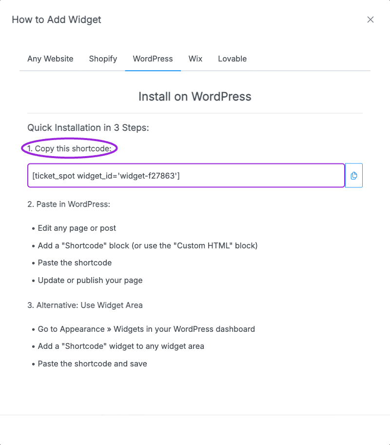

The Ticket Spot WordPress plugin displays your event widget inside a WordPress page or post. Create events and manage orders in Ticket Spot, then use a shortcode to place the widget on your website.

## Before you start

You need a WordPress account with permission to install plugins and edit the page. Your WordPress hosting or plan must allow plugin installation. You also need a Ticket Spot account and an event; use the [first-event guide](/getting-started/first-event) if you have not created one yet.

For paid tickets through Ticket Spot checkout, open **Account → Get Paid** and [connect your payment provider](/account/get-paid). Free registration does not require a provider. Review [Ticket Spot plan requirements](/account/billing-and-plans) for the features you plan to use.

## Install the plugin and widget

<Steps>
<Step title="Install and activate">
In WordPress, open **Plugins → Add New**, search for **Ticket Spot**, and choose **Install Now**, then **Activate**. The official listing is [Ticket Spot – Event Tickets, RSVPs & Calendar](https://wordpress.org/plugins/ticket-spot/), by ticketspot.

You can also download the ZIP from that listing and use **Plugins → Add New → Upload Plugin**, then activate it.
</Step>
<Step title="Connect your site">
Open **Settings → Ticket Spot**, sign in, and choose or create the Ticket Spot site for this website. In Ticket Spot, open **Design → Widget**, choose the widget in **Editing Widget**, then open **Installation → WordPress** and copy its generated shortcode.
</Step>
<Step title="Add the shortcode">
Edit the WordPress page and add a **Shortcode** block. Paste the generated shortcode. Its format is:

```text
[ticket_spot widget_id="YOUR_WIDGET_ID"]
```

Use your actual widget ID, not an event ID or site ID.
</Step>
<Step title="Publish and test">
Publish the event in Ticket Spot, then update or publish the WordPress page. Open the published URL as a visitor and check desktop and mobile views. Verify the event list loads, the correct event opens, and its tickets and prices are correct.
</Step>
</Steps>

<Frame caption="The WordPress installation tab gives the shortcode for the selected widget. Copy it into a Shortcode block on a site with the Ticket Spot plugin active.">
  
</Frame>

Set your [Brand colors and logo](/branding-and-design/brand-design) first, then adjust [Widget design](/branding-and-design/widget-customization-overview). Update events in Ticket Spot without replacing the shortcode each time.

## Complete a test registration

Place a test order through the published WordPress page using the checkout you will offer attendees. Check the confirmation and ticket link, then find the attendee and order in Ticket Spot. For paid tickets, also verify the payment with your connected provider. Follow the [launch checklist](/getting-started/launch-checklist) before sharing your page.

## Troubleshooting

If the page shows literal shortcode text, check that the plugin is active and the shortcode is in a Shortcode block. If no events appear, verify the widget ID, event visibility, and widget filters. After changes, refresh any WordPress page cache.

## Next steps

- [Choose a calendar or list layout](/branding-and-design/layout).
- [Customize ticket confirmations](/event-management/email-communication).
- [Explore features for your event](/guides/overview).
