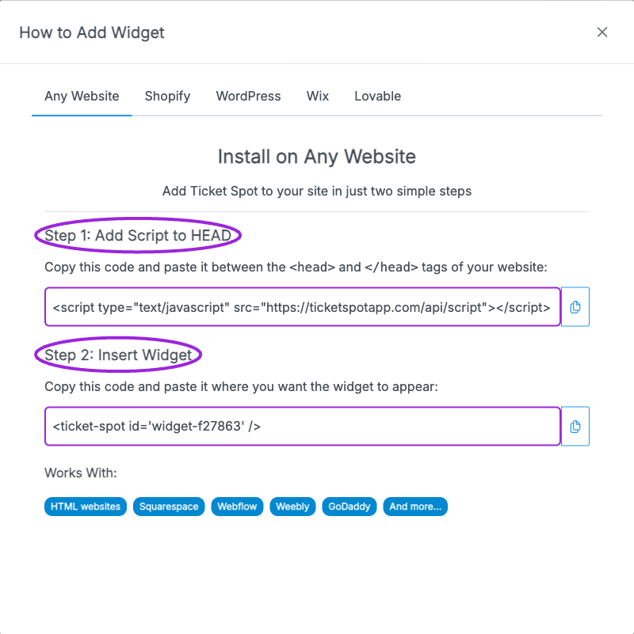

Use the widget installation code generated for your Ticket Spot site to add an event calendar or ticket listing to your website. This route works with website builders that allow custom JavaScript and HTML, including Squarespace, and with a website you manage yourself. Visitors can browse events and continue to the ticket selection and checkout supported by your integration.

## Before you start

- You need access to the website's custom head code and page HTML. Check that your website plan permits custom scripts, not only an iframe or a link embed.
- Create an event with tickets and publish it in Ticket Spot. Follow [Create your first event](/getting-started/first-event) if needed.
- For Ticket Spot checkout, [connect a payment provider](/account/get-paid) before selling paid tickets. Free registration does not require a payment connection.

For a builder-specific route, use [Squarespace](/plugins/connect-squarespace). Native setup guides are available for [Shopify](/plugins/connect-shopify), [Wix](/plugins/connect-wix), [Ecwid](/plugins/connect-ecwid), and [WordPress](/plugins/connect-wordpress). Compare these options in [Website setup](/plugins/website-setup).

## Install the widget

1. Create or select the Ticket Spot site for the website.
2. Set up [Brand identity](/branding-and-design/brand-design) and [Widget design](/branding-and-design/widget-customization-overview).
3. In **Design → Widget**, select the widget in **Editing Widget** and click **Installation**. Choose **Any Website**. It supplies two code snippets for the selected widget.
4. Under **Step 1: Add Script to HEAD**, copy the script into the website’s `<head>` section or its custom head-code setting. Under **Step 2: Insert Widget**, copy the widget container into the HTML or embed area where the event list should appear. Both snippets are required, and the builder must permit custom scripts.
5. Publish the page and open the published URL. Some editors do not run scripts in their editing canvas.
6. Check the event list, calendar filters, ticket selection, checkout, and confirmation on desktop and mobile.

<Frame caption="Any Website supplies two pieces: the script for the page head, then the widget container where the event list should appear.">
  
</Frame>

Building with Lovable? Use the [generated installation prompt](/plugins/connect-lovable).

## Choose an event calendar layout

To display an event calendar, open **Design → Widget → All Settings → Layout** and choose the appropriate desktop calendar layout. Configure **Mobile** and **Date & time** separately. Follow the [widget layout guide](/branding-and-design/layout) for calendar views, visible hours, and time-slot display; then install the same widget using the steps above.

## Choose the checkout route

The widget is the event-selection surface. A standalone Ticket Spot widget uses your connected Ticket Spot payment provider. Shopify and Ecwid product purchases use their respective store checkouts; follow that platform's guide when publishing products. A hosted Ticket Spot event page is a separate shareable destination. A custom domain controls the supported hosted pages and does not change which payment provider processes the order.

## Test the published page

Open the page in a private browser window and complete a registration using the ticket type and checkout you will offer visitors. Confirm the date, price, required questions, confirmation, and ticket link. Find the resulting attendee and order in Ticket Spot; for paid tickets, check the payment provider as well. Repeat the browsing and ticket-selection check on mobile.

Use the [launch checklist](/getting-started/launch-checklist) before you promote the event.

## Troubleshooting

If the widget is blank, confirm the complete script is allowed, the correct widget was selected, and its filters include a visible event. Compare with the event's public page to separate a listing filter problem from an event configuration problem.

## Related guides

- [Hosted domains and analytics](/site-settings/domain-and-analytics)
- [Connect payment providers](/account/get-paid)
- [Tracking links](/event-management/tracking-links)
- [Explore features for your event](/guides/overview)
